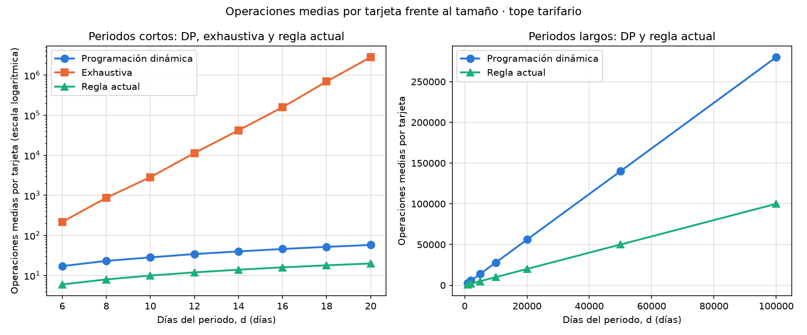

# Conciliación nocturna del recaudo del SITVM

**Análisis de Algoritmos · 2026-2 · Proyecto final · Caso de estudio 1**

**Integrantes:**
- Sebastián Jesús Pérez Araujo · sebastianperez1116036@correo.itm.edu.co ([@SESASAN](https://github.com/SESASAN))
- Geremy Santa Duque · geremysanta1117442@correo.itm.edu.co ([@GereSanta07](https://github.com/GereSanta07))
- Nathalie Gabriela Miranda Rejón · nathaliemiranda1117738@correo.itm.edu.co ([@NathyGaby04](https://github.com/NathyGaby04))
- Samuel Quiroz Rincón · samuelquiroz1113937@correo.itm.edu.co ([@Samuzarter](https://github.com/Samuzarter))

**Operaciones abordadas:**
- Operación 4: liquidación del tope tarifario (Laboratorio 4, programación dinámica)
- Operación 3: detección de las franjas de congestión (entrega del 23 de noviembre)

---

## 1. Análisis del problema

### 1.1 Descripción del problema computacional

El Sistema Integrado de Transporte del Valle Metropolitano (SITVM) necesita procesar diariamente la información generada por las validaciones de los usuarios en los diferentes medios de transporte que lo conforman, entre ellos el metro, las líneas de cable y los buses alimentadores.

Este procesamiento se realiza durante la noche mediante un proceso por lotes que debe preparar la información para las áreas de Recaudo, Atención al Usuario y Planeación. Para ello, se deben ejecutar cuatro operaciones principales: eliminar las validaciones duplicadas, ordenar los registros por tarjeta y fecha, identificar los intervalos de mayor congestión en las estaciones y calcular el costo mínimo que debe pagar cada usuario según los productos tarifarios disponibles.

Actualmente, el procesamiento completo tarda más de ocho horas, mientras que el tiempo disponible para realizarlo es de cuatro horas, entre las 00:00 y las 04:00. Esta diferencia representa un problema operativo, ya que a las 04:30 comienzan a abrir las estaciones y los validadores necesitan disponer de información actualizada, especialmente de las listas de tarjetas reportadas como robadas o extraviadas.

Parte de la demora se relaciona con las estrategias utilizadas actualmente. Por ejemplo, la eliminación de duplicados compara cada validación con los registros previamente aceptados; el ordenamiento utiliza el método de inserción; la detección de congestión evalúa todos los intervalos consecutivos posibles; y la liquidación del tope tarifario explora combinaciones de productos, recurriendo a una regla simplificada cuando el procesamiento resulta demasiado costoso.

Por lo tanto, el problema consiste en analizar e implementar estrategias algorítmicas que permitan mejorar el rendimiento de las operaciones seleccionadas, manteniendo la exactitud de los resultados y respetando las restricciones del sistema. El objetivo es contribuir a que el procesamiento pueda ejecutarse dentro de la ventana nocturna disponible, sin perder validaciones ni afectar los cobros de los usuarios.

### 1.2 Entradas, salidas y restricciones

#### Operación 4 · Tope tarifario

Al cierre de cada mes, el sistema debe revisar cada tarjeta personalizada para verificar que el valor cobrado no supere el costo de la combinación más económica de pasajes y pases que cubra todos los viajes realizados. Si se identifica un cobro superior al mínimo, la diferencia se devuelve al usuario como saldo a favor. Para el análisis, el problema se modela sobre una sola tarjeta y un solo mes.

**Entradas:**

- **`viajes_por_dia`:** lista de enteros no negativos con la cantidad de viajes que realizó la tarjeta cada día del mes. La posición 0 corresponde al día 1 y un día sin viajes tiene un valor de 0. Su longitud `d` representa el número de días del mes, entre 28 y 31.
- **`cobrado`:** valor en pesos que se descontó a la tarjeta durante el mes. Este valor se utiliza únicamente para calcular la devolución correspondiente.
- **Tarifas del perfil general:** son fijas y se resumen en la siguiente tabla.

| Producto | Valor | Cobertura |
|---|---:|---|
| Pasaje sencillo | $3.900 | Un viaje |
| Pase diario | $9.500 | Viajes ilimitados durante un día calendario |
| Pase semanal | $36.000 | Viajes ilimitados durante 7 días consecutivos |
| Pase mensual | $135.000 | Viajes ilimitados durante 30 días consecutivos |

**Salidas:**

- **Costo mínimo:** valor en pesos de la combinación de productos más económica que cubre todos los viajes del mes (`costo_minimo`).
- **Devolución:** diferencia entre el valor cobrado y el costo mínimo, que nunca puede ser negativa (`liquidar_tope`). Si a la tarjeta se le cobró el mínimo o menos, la devolución es 0.

**Restricciones:**

- **Devolución exacta:** la devolución debe corresponder exactamente a la diferencia entre lo cobrado y la combinación más económica, sin devolver al usuario menos de lo que le corresponde ni más de lo que corresponde. Por esta razón, no se permiten aproximaciones y todos los valores se manejan como pesos enteros, sin decimales.
- **Cobertura completa:** la combinación elegida debe cubrir todos los días en los que se realizaron viajes. Un pase semanal o mensual cubre días consecutivos a partir del día en que se compra.
- **Ventana operativa:** la operación se ejecuta durante la noche del cierre de mes, dentro de la ventana de 4 horas (00:00 a 04:00) que comparte con las operaciones 1 y 2.
- **Volumen:** aproximadamente 950.000 tarjetas se utilizan al menos una vez al mes y todas deben liquidarse dentro de esa misma ventana.
- **Infraestructura:** se dispone de un único servidor de aproximadamente 500 W, sin procesamiento en paralelo ni distribuido.

| Elemento | Unidad | Límite del caso |
|---|---|---|
| Días del periodo (`d`) | días | 28 a 31 |
| Viajes por día | viajes | Entero mayor o igual a 0 |
| Costos y devoluciones | pesos enteros | Devolución mayor o igual a 0 |
| Tarjetas por cierre de mes | tarjetas | ≈ 950.000 |
| Ventana de ejecución | horas | 4 (00:00 – 04:00) |
| Potencia del servidor | vatios | ≈ 500 W |

#### Operación 3 · Franjas de congestión

La operación busca identificar, para cada estación del sistema, el intervalo consecutivo de mayor congestión a partir del balance neto de pasajeros registrado cada cinco minutos. Este balance corresponde a la diferencia entre los pasajeros que ingresan a la plataforma y los que son evacuados mediante los trenes. El resultado permite reconocer los periodos en los que se presenta la mayor acumulación de pasajeros.

**Entradas:**

- **`saldos`**: lista de números enteros que representa el balance neto de pasajeros de una estación en cada intervalo de cinco minutos. Cada posición corresponde a un intervalo de tiempo y su valor puede ser positivo, negativo o cero.
- **Datos por estación**: la operación se realiza sobre la secuencia de saldos de cada estación de manera independiente. El sistema cuenta con 80 estaciones.
- **Periodo de análisis**: se pueden procesar registros históricos de aproximadamente dos años, equivalentes a cerca de 166.000 intervalos de cinco minutos por estación.

**Salidas:**

- **Intervalo de mayor congestión**: tramo de intervalos consecutivos cuya suma de balances netos sea la mayor de toda la secuencia.
- **Índice de inicio (`inicio`)**: posición del primer intervalo que conforma el tramo encontrado.
- **Índice de finalización (`fin`)**: posición del último intervalo que conforma el tramo encontrado. Los índices comienzan en 0 y ambos extremos se incluyen.
- **Suma máxima (`suma`)**: valor total del balance neto acumulado en el intervalo identificado.

La operación devuelve una tupla con la estructura `(inicio, fin, suma)`.

**Restricciones:**

- **Continuidad del intervalo**: el tramo seleccionado debe estar formado por intervalos consecutivos, sin saltarse posiciones de la secuencia.
- **Resultado exacto**: se debe encontrar el intervalo cuya suma sea la máxima posible. No se permiten aproximaciones ni resultados que omitan un intervalo con una suma superior.
- **Valores negativos**: los balances netos pueden ser negativos, por lo que la estrategia debe contemplar tanto acumulaciones como periodos en los que la cantidad de pasajeros evacuados supera la cantidad de pasajeros que ingresan.
- **Tamaño de los datos**: cada estación puede contar con aproximadamente 166.000 registros para un periodo histórico de dos años. El análisis debe considerar este volumen, ya que evaluar todos los intervalos consecutivos posibles puede requerir un tiempo de ejecución elevado.
- **Frecuencia de registro**: los datos se generan cada cinco minutos, lo que equivale a 288 intervalos por día si se considera un día completo. Para el escenario operativo del caso se manejan aproximadamente 228 intervalos diarios.
- **Infraestructura**: el procesamiento se realiza en un único servidor de aproximadamente 500 W, sin procesamiento paralelo ni distribuido.

| Elemento | Unidad | Característica del caso |
|---|---|---|
| Intervalo de registro | Minutos | 5 |
| Registros diarios por estación | Intervalos | ≈ 228 |
| Estaciones | Estaciones | 80 |
| Periodo histórico | Años | 2 |
| Registros por estación (dos años) | Intervalos | ≈ 166.000 |
| Balance neto | Pasajeros | Puede ser positivo, negativo o cero |
| Resultado | Tupla | `(inicio, fin, suma)` |
| Potencia del servidor | Vatios | ≈ 500 W |

### 1.3 Operaciones críticas del proceso
_Pendiente para la entrega del 23 de noviembre._

### 1.4 Costo energético del proceso actual (línea base)
_Pendiente para la entrega del 23 de noviembre._

### 1.5 Supuestos del equipo

Para desarrollar la solución del caso de liquidación del tope tarifario, el equipo estableció los siguientes supuestos de interpretación:

- **Interpretación de la regla simplificada actual:** se interpreta que los primeros treinta días del mes se dividen en bloques fijos: días 1 al 7, 8 al 14, 15 al 21, 22 al 28 y 29 al 30. Primero, para cada día se calcula el menor costo entre pagar los viajes con pasajes sencillos y utilizar el pase diario. Después, se suman los costos diarios de cada bloque y se limita ese valor al precio del pase semanal ($36.000). Finalmente, al acumulado de los primeros treinta días se le aplica el límite del pase mensual ($135.000). Por ejemplo, si durante los primeros siete días se realizan tres viajes diarios, el costo de los pasajes sería de $81.900. Al aplicar el pase diario, el costo de cada día queda en $9.500, para un acumulado de $66.500. Como este valor supera los $36.000 del pase semanal, la regla cobra $36.000 por ese bloque.

- **Duración de los meses:** se considera que el periodo de liquidación corresponde a un mes calendario, que puede tener entre 28 y 31 días. La cantidad de días procesados depende del periodo recibido como entrada. Para la interpretación de la regla actual, los primeros treinta días se procesan con los límites semanal y mensual, mientras que, en los meses de 31 días, el día 31 se cobra por separado, aplicando el menor costo entre los pasajes sencillos y el pase diario.

- **Pases que exceden el mes:** cuando un pase semanal o mensual comprado en los últimos días del mes tiene una cobertura que supera el periodo analizado, se considera únicamente la cobertura correspondiente a los días restantes del mes. Sin embargo, se mantiene el precio completo del pase, ya que no se supone un descuento proporcional por los días que quedan fuera del periodo.

- **Perfiles diferenciales:** se supone que los perfiles tarifarios diferenciales conservan la misma estructura de productos y reglas de cobertura, pero utilizan tarifas distintas. La implementación de este laboratorio trabaja con los valores del perfil general definidos en el enunciado; los demás perfiles requerirían proporcionar sus tarifas correspondientes.

- **Validez de los datos:** se supone que las entradas son válidas y consisten en una lista de cantidades enteras no negativas, donde cada posición representa un día del mes y su valor indica la cantidad de viajes realizados. Una lista vacía representa un periodo sin viajes.

- **Procesamiento en memoria y un solo hilo:** las instancias se procesan en memoria, de manera secuencial y utilizando un único hilo de ejecución. No se contempla procesamiento paralelo ni almacenamiento externo durante la ejecución de los algoritmos.

- **Datos sintéticos:** para las pruebas y mediciones se utilizan instancias generadas artificialmente, con semillas fijas cuando se requiere reproducibilidad. Estos datos permiten evaluar el comportamiento de los algoritmos sin utilizar información personal o registros reales de tarjetas.

- **Exactitud de la liquidación:** el costo óptimo debe cubrir todos los viajes del periodo al menor valor posible. La devolución debe corresponder exactamente a la diferencia entre el valor cobrado y el costo mínimo, sin generar devoluciones negativas.

---

## 2. Diseño de la solución

### 2.1 Estructuras de datos seleccionadas

#### Operación 4 · Tope tarifario

| Estructura | Qué almacena | Motivo de elección |
|---|---|---|
| Lista de enteros `viajes_por_dia` | Cantidad de viajes de cada día. La posición 0 representa el día 1. | Es la información de entrada. Su longitud indica cuántos días tiene el periodo (normalmente entre 28 y 31), por lo que no es necesario asumir que todos tienen 30 días. |
| Lista `costos` de tamaño d + 2 | `costos[t]` = C(t). El valor `costos[d+1] = 0` corresponde al caso base. | Los estados van del día 1 al d + 1 y no tienen posiciones intermedias vacías. Al usar una lista, consultar un día cuesta O(1). Un diccionario no sería necesario porque todos los estados se calculan y ocuparía más memoria. |
| Lista `elecciones` de tamaño d + 2 | Producto seleccionado para cada día. | Permite reconstruir las compras realizadas y verificar que su costo total sea exactamente C(1). Sin esta lista solo conoceríamos el costo mínimo. |
| Tupla `PASES` | Nombre, precio y días de cobertura de los pases semanal y mensual. | Permite evaluar los pases mediante un solo ciclo. Si cambian las tarifas, se pueden modificar sus valores sin alterar la lógica principal. |
| Enteros en pesos | Valores de todos los costos. | Permiten calcular las devoluciones sin errores de redondeo que podrían aparecer al utilizar `float`. |

**Espacio:** Θ(d), donde d representa la cantidad de días del periodo. Si únicamente se necesitara conocer el costo mínimo, bastaría con conservar una ventana de 31 posiciones, porque ningún pase consulta más de 30 días hacia adelante. Sin embargo, se almacena toda la tabla para poder reconstruir las compras y revisar cada liquidación.

#### Operación 3 · Franjas de congestión

Para la operación 3 bastan dos estructuras:

- **Lista de saldos (`list[int]`).** Contiene la serie de una estación: una posición por intervalo de 5 minutos, con el saldo neto de la plataforma (pasajeros que entraron menos los que los trenes alcanzaron a evacuar), que puede ser negativo. La lista se recibe y se recorre, pero nunca se modifica.
- **Tupla del tramo (`Tramo = tuple[int, int, int]`).** Representa la respuesta como `(inicio, fin, suma)`, con índices desde 0 e inclusivos. Es inmutable, así que un subproblema no puede alterar por accidente el resultado de otro, y ocupa espacio constante.

Dividir y vencer no necesita copiar sublistas. Cada subproblema se identifica con dos enteros, `bajo` y `alto`, que delimitan su rango dentro de la misma lista original. Si cada llamada recibiera una copia (`saldos[bajo:medio + 1]`), cada nivel de la recursión copiaría en total n saldos. Eso suma Θ(n log n) de trabajo adicional, pero la memoria máxima ocupada por las copias sería Θ(n), porque solo se mantienen las copias de una rama de recursión y sus tamaños forman una suma geométrica. Con índices, la memoria adicional se reduce a la pila de llamadas, de profundidad Θ(log n). Además, como la serie nunca se duplica ni se altera, se respeta la restricción de no modificar los datos originales.

### 2.2 Operación 4 · Tope tarifario

#### Por qué el problema admite programación dinámica

**Subestructura óptima.** El costo de una tarjeta puede dividirse en dos partes:

- Lo que se compra el primer día con viajes que todavía falta por pagar.
- El costo mínimo de cubrir los días restantes del periodo.

La segunda parte representa el mismo problema, pero comienza en un día posterior. Para tomar la siguiente decisión solo necesitamos saber desde qué día todavía hay viajes por pagar. Así, podemos resolver el problema completo utilizando las soluciones óptimas de problemas más pequeños.

Además, el costo de los días restantes también debe ser óptimo. Si se utilizara una solución más costosa de lo necesario, podríamos reemplazarla por la alternativa más barata y reducir el total. Por eso, una solución que no optimice el resto tampoco puede ser óptima para el problema completo.

**Subproblemas que se repiten.** En el ejemplo resuelto a mano (más abajo), el estado C(8), que representa el costo de pagar desde el día 8 hasta el final del periodo, se alcanza mediante dos caminos:

- **Camino A:** comprar un pase semanal el día 1, que cubre del día 1 al 7.
- **Camino B:** comprar un pasaje el día 1, no comprar nada los días 2 y 3 porque no hay viajes, y pagar únicamente los viajes de cada día entre el 4 y el 7.

Con C(9) ocurre algo similar. Se puede llegar a este estado de dos maneras:

- Comprar un semanal en cualquier día con viajes entre el 4 y el 8. Los días que queden por fuera del periodo se recortan hasta llegar al día 9.
- Pagar únicamente los viajes del día 8.

Los días 2 y 3 no afectan estas decisiones porque no tienen viajes. La recurrencia simplemente toma el costo del día siguiente y no realiza ninguna compra.

Una solución exhaustiva vuelve a calcular C(8) y C(9) cada vez que encuentra esos caminos. En cambio, la programación dinámica guarda sus resultados y los reutiliza.

**Por qué no basta decidir día por día.** Los pases semanal y mensual cubren varios días al mismo tiempo. Por ejemplo, si se compra un semanal en el día t, los seis días siguientes ya quedan cubiertos. Por eso, elegir el precio más barato para cada día de manera independiente no permite identificar todas las combinaciones posibles.

#### Ejemplo resuelto a mano

**Datos de entrada:** viajes = [1, 0, 0, 2, 3, 2, 3, 3]. El caso base es C(9) = 0.

| Día | Viajes | Solo ese día | Semanal | Mensual | C | Gana |
|---|---|---|---|---|---|---|
| 9 | — | — | — | — | 0 | caso base |
| 8 | 3 | 9.500 + 0 = 9.500 | 36.000 + C(9) = 36.000 | 135.000 | 9.500 | diario |
| 7 | 3 | 9.500 + 9.500 = 19.000 | 36.000 | 135.000 | 19.000 | diario |
| 6 | 2 | 7.800 + 19.000 = 26.800 | 36.000 | 135.000 | 26.800 | pasajes |
| 5 | 3 | 9.500 + 26.800 = 36.300 | 36.000 | 135.000 | 36.000 | semanal |
| 4 | 2 | 7.800 + 36.000 = 43.800 | 36.000 + C(9) = 36.000 | 135.000 | 36.000 | semanal |
| 3 | 0 | se copia C(4) | | | 36.000 | — |
| 2 | 0 | se copia C(3) | | | 36.000 | — |
| 1 | 1 | 3.900 + 36.000 = 39.900 | 36.000 + C(8) = 45.500 | 135.000 | **39.900** | pasaje |

**Interpretación de los resultados:**

- **Día 5:** la diferencia entre pagar por separado y comprar el semanal es de apenas 300 pesos. Los pagos diarios de los días 5 al 8 suman 36.300, mientras que el semanal cuesta 36.000.
- **Día 1:** comprar el semanal desde este día resulta más caro por dos motivos: cubre los días 2 y 3, que no tienen viajes, y no alcanza a cubrir el día 8, que debe pagarse por separado (C(8) = 9.500). Por eso, esta alternativa cuesta 36.000 + 9.500 = 45.500. Es mejor pagar el pasaje del primer día y comenzar el semanal en el día 4.

**Compras seleccionadas.** Para reconstruirlas, se comienza en el día 1 y se sigue la opción que ganó en cada fila:

- **Día 1:** se compra un pasaje de 3.900.
- **Días 2 y 3:** no se compra nada porque no hay viajes.
- **Día 4:** se compra un semanal de 36.000. Este cubre hasta el día 10, por lo que ya no es necesario realizar más compras durante el periodo.

**Costo total: 39.900.** Los resultados de los días 5 al 8 no se utilizan en la reconstrucción, porque el semanal comprado el día 4 ya cubre esos viajes.

**Comparación con la regla actual:** en esta misma instancia la regla cobra 45.500, es decir, 5.600 pesos más que el costo óptimo, porque solo aplica el semanal sobre el bloque fijo de los días 1 a 7 (ver §5.1).

#### Recurrencia

```text
hoy(t) = min(viajes_t · 3.900, 9.500)

C(d+1) = 0
C(t)   = C(t+1)                                   si el día t no tiene viajes
C(t)   = mín{ hoy(t) + C(t+1),
              36.000  + C(min(t+7,  d+1)),
              135.000 + C(min(t+30, d+1)) }       si tiene viajes
```

**Significado de cada elemento:**

- **C(t):** representa el costo mínimo para cubrir los viajes desde el día t hasta el final del periodo. Se asume que los días anteriores ya están pagos y que ninguna compra anterior cubre el día actual. El resultado final es C(1), y la devolución se calcula como `max(0, cobrado − C(1))`.
- **hoy(t):** calcula la alternativa más económica para pagar únicamente el día t, comparando los pasajes individuales con el pase diario. A partir de 3 viajes conviene el diario, porque 11.700 es mayor que 9.500.
- **Las tres alternativas:** cada opción suma el precio de la compra actual al costo mínimo de los días que todavía quedan sin cubrir. Si se paga solo el día actual, se continúa desde t + 1; con el semanal, desde t + 7; y con el mensual, desde t + 30.
- **El límite d + 1:** evita consultar posiciones fuera de la tabla cuando un pase supera la duración del periodo. En ese caso, se llega al caso base.
- **Días sin viajes:** no requieren compras, por lo que se conserva el costo calculado para el día siguiente.

**Caso base.** C(d + 1) = 0, porque representa una posición en la que ya no quedan días por pagar.

**Orden de cálculo.** Como cada estado depende de días posteriores, primero se calcula C(d + 1) y luego se avanza en sentido descendente hasta C(1). De esta manera, cuando se necesita consultar otro estado, su valor ya está calculado.

#### Estrategias diseñadas

**Programación dinámica (propuesta)**

```text
función costo_minimo(viajes):
    d ← largo(viajes)
    costos[1..d+1] ← 0
    elecciones[1..d+1] ← "nada"

    para t desde d hasta 1:
        si viajes[t] = 0:
            costos[t] ← costos[t+1]
            continuar

        costos[t] ← hoy(t) + costos[t+1]
        elecciones[t] ← "pasajes" si viajes[t]·3900 < 9500, si no "diario"

        para cada (nombre, precio, L) en [(semanal, 36000, 7), (mensual, 135000, 30)]:
            cand ← precio + costos[min(t+L, d+1)]
            si cand < costos[t]:
                costos[t] ← cand
                elecciones[t] ← nombre

    devolver costos[1]
```

El tiempo de ejecución es Θ(d), ya que para cada día se revisan como máximo tres alternativas. El espacio utilizado también es Θ(d), debido a las dos tablas.

**Exhaustiva (solución exacta para verificar)**

```text
función exh(viajes, t):
    si t > d: devolver 0
    si viajes[t] = 0: devolver exh(viajes, t+1)

    mejor ← viajes[t] * 3900 + exh(viajes, t+1)
    mejor ← min(mejor, 9500 + exh(viajes, t+1))
    mejor ← min(mejor, 36000 + exh(viajes, t+7))
    mejor ← min(mejor, 135000 + exh(viajes, t+30))

    devolver mejor
```

La estrategia exhaustiva evalúa todas las combinaciones posibles de compra de productos tarifarios, sin almacenar los resultados de los subproblemas ya resueltos. Su complejidad espacial es Θ(d), la cual se encuentra determinada por la profundidad máxima de las llamadas recursivas. El análisis de su complejidad temporal se desarrolla en la sección 4.1.

**Regla actual (línea base).** Sigue la interpretación descrita en §1.5.

```text
función regla_actual(viajes):
    n ← min(d, 30)
    total ← 0

    para cada bloque de 7 días dentro de 1..n:
        total ← total + min(Σ hoy(t) en el bloque, 36000)

    total ← min(total, 135000)

    para t de 31 a d:
        total ← total + hoy(t)

    devolver total
```

Su tiempo de ejecución es Θ(d), igual que el de la programación dinámica. La diferencia entre ambas está en el resultado que calculan, no en el costo computacional.

**Alcance de la regla.** Esta interpretación está pensada para liquidar un solo mes (d ≤ 31). En la Serie 2 de `medicion.py` la regla se ejecuta con periodos mayores únicamente para medir su tiempo de ejecución; sus cobros no se comparan con el óptimo.

**Diagrama de dependencias de la DP**

```text
C(t) ──hoy────▶ C(t+1)
  ├───semanal─▶ C(min(t+7,  d+1))
  └───mensual─▶ C(min(t+30, d+1))

orden de cálculo: C(d+1) → C(d) → … → C(2) → C(1)
```

### 2.3 Operación 3 · Franjas de congestión

#### Por qué el problema admite dividir y vencer

Si la serie se parte por la mitad, en `medio`, el tramo de mayor suma solo puede estar en uno de tres lugares:

1. **Completamente en la mitad izquierda** (`bajo … medio`).
2. **Completamente en la mitad derecha** (`medio + 1 … alto`).
3. **Cruzando el punto medio:** empieza en la izquierda y termina en la derecha, así que contiene obligatoriamente a `medio` y a `medio + 1`.

Los dos primeros casos son el mismo problema sobre la mitad de los datos, y se resuelven recursivamente. El tercero no es un problema recursivo: un tramo que cruza el medio es la unión de dos piezas independientes. Una es el mejor sufijo de la mitad izquierda, que termina en `medio`; la otra es el mejor prefijo de la mitad derecha, que empieza en `medio + 1`. Cada pieza se encuentra con un solo recorrido lineal desde el medio hacia afuera.

La respuesta del rango es la mayor de las tres. Como cualquier tramo consecutivo necesariamente pertenece a uno de estos casos, no se omite ninguna posibilidad y el algoritmo encuentra el máximo exacto, no una aproximación.

#### Recurrencia

Cada llamada sobre n intervalos hace dos llamadas sobre n/2 y un trabajo lineal para el tramo cruzado:

```text
T(1) = Θ(1)
T(n) = 2·T(n/2) + Θ(n)
```

Por el teorema maestro, con a = 2, b = 2 y f(n) = Θ(n), estamos en el caso 2, así que T(n) = Θ(n log n). Intuitivamente, hay log₂ n niveles de recursión y en cada nivel los recorridos de cruce suman, entre todos, n intervalos. El espacio adicional es Θ(log n), por la pila de llamadas. Para el histórico de dos años (n ≈ 166.000), la profundidad es de unas 18 llamadas.

#### Pseudocódigo

```text
TRAMO-MÁXIMO(saldos, bajo, alto):
    si bajo == alto:
        devolver (bajo, alto, saldos[bajo])
    medio ← (bajo + alto) // 2
    izq   ← TRAMO-MÁXIMO(saldos, bajo, medio)
    der   ← TRAMO-MÁXIMO(saldos, medio + 1, alto)
    cruce ← TRAMO-CRUZADO(saldos, bajo, medio, alto)
    devolver el de mayor suma entre izq, der y cruce

TRAMO-CRUZADO(saldos, bajo, medio, alto):
    mejor_izq ← −∞
    inicio ← medio
    suma ← 0
    para i desde medio bajando hasta bajo:
        suma ← suma + saldos[i]
        si suma > mejor_izq:
            mejor_izq ← suma
            inicio ← i

    mejor_der ← −∞
    fin ← medio + 1
    suma ← 0
    para j desde medio + 1 hasta alto:
        suma ← suma + saldos[j]
        si suma > mejor_der:
            mejor_der ← suma
            fin ← j

    devolver (inicio, fin, mejor_izq + mejor_der)
```

#### Ejemplo resuelto a mano

Serie de 8 intervalos (índices 0 a 7):

| Índice | 0 | 1 | 2 | 3 | 4 | 5 | 6 | 7 |
|---|---|---|---|---|---|---|---|---|
| Saldo | 3 | −5 | 4 | 2 | −1 | 6 | −8 | 2 |

La tabla muestra, para cada rango, los tres candidatos y el ganador. Los rangos de un solo intervalo son casos base y devuelven su propio saldo.

| Rango | Medio | Izquierdo | Derecho | Cruzado | Ganador |
|---|---:|---|---|---|---|
| [0, 1] | 0 | (0, 0, 3) | (1, 1, −5) | 3 + (−5) → (0, 1, −2) | **(0, 0, 3)** |
| [2, 3] | 2 | (2, 2, 4) | (3, 3, 2) | 4 + 2 → (2, 3, 6) | **(2, 3, 6)** |
| [4, 5] | 4 | (4, 4, −1) | (5, 5, 6) | −1 + 6 → (4, 5, 5) | **(5, 5, 6)** |
| [6, 7] | 6 | (6, 6, −8) | (7, 7, 2) | −8 + 2 → (6, 7, −6) | **(7, 7, 2)** |
| [0, 3] | 1 | (0, 0, 3) | (2, 3, 6) | Sufijo izq. −2 (desde 0) + prefijo der. 6 (hasta 3) → (0, 3, 4) | **(2, 3, 6)** |
| [4, 7] | 5 | (5, 5, 6) | (7, 7, 2) | Sufijo izq. 6 (desde 5) + prefijo der. −6 (hasta 7) → (5, 7, 0) | **(5, 5, 6)** |
| [0, 7] | 3 | (2, 3, 6) | (5, 5, 6) | Sufijo izq. 6 (desde 2) + prefijo der. 5 (hasta 5) → **(2, 5, 11)** | **(2, 5, 11)** |

En el último nivel, el cruce recorre hacia la izquierda desde el índice 3: las sumas acumuladas son 2, 6, 1 y 4, y la mejor es 6, empezando en el índice 2. Hacia la derecha desde el índice 4, las sumas son −1, 5, −3 y −1, y la mejor es 5, terminando en el índice 5.

**Respuesta: el tramo de los intervalos 2 a 5, con 4 + 2 − 1 + 6 = 11 pasajeros acumulados.** Ninguna de las dos mitades por sí sola encuentra este tramo; por eso hace falta el caso cruzado.

Conteo de operaciones del ejemplo, con el contador del código (cada intervalo sumado):

- Casos base: 8.
- Cruces de rangos de tamaño 2: 4 × 2 = 8.
- Cruces de rangos de tamaño 4: 2 × 4 = 8.
- Cruce del rango de tamaño 8: 8.

Total: **32 = n·(log₂ n + 1)**. La fuerza bruta, que evalúa todos los tramos sumando incrementalmente, hace n(n + 1)/2 = **36**. Con 8 intervalos casi no hay diferencia; la ventaja aparece al crecer n.

#### Cómo reduce el consumo energético frente a la fuerza bruta

El servidor consume una potencia aproximadamente constante, de unos 500 W bajo carga, así que la energía de un proceso es E = P × t, y el tiempo de ejecución influye directamente en el consumo. Reducir el tiempo de procesamiento puede reducir la energía utilizada.

La fuerza bruta evalúa los n(n + 1)/2 tramos posibles. Dividir y vencer hace del orden de n(log₂ n + 1) sumas. Para el histórico de dos años de una estación (n ≈ 166.000):

| Estrategia | Operaciones por estación | Para las 80 estaciones |
|---|---:|---:|
| Fuerza bruta, Θ(n²) | ≈ 1,38 × 10¹⁰ | ≈ 1,1 × 10¹² |
| Dividir y vencer, Θ(n log n) | ≈ 3,06 × 10⁶ | ≈ 2,4 × 10⁸ |

Dividir y vencer hace unas **4.500 veces menos operaciones**, y la proporción crece con la serie: si el histórico se duplica, la fuerza bruta cuadruplica su trabajo, mientras que dividir y vencer lo multiplica por poco más de 2.

Con las mediciones de ejecución se podrá estimar el consumo energético de ambas estrategias utilizando E = P × t, considerando la potencia del servidor y el tiempo que tarda cada algoritmo. Esto permite evaluar cuánto recurso se requiere para procesar el histórico completo de las estaciones.

---

## 3. Implementación

### 3.1 Operación 4 · Tope tarifario

Código en [`src/tope_tarifario/`](src/tope_tarifario/):

| Módulo | Contenido |
|---|---|
| [`estrategia.py`](src/tope_tarifario/estrategia.py) | `costo_minimo` (programación dinámica) y `liquidar_tope` |
| [`exhaustivo.py`](src/tope_tarifario/exhaustivo.py) | `costo_exhaustivo`, que prueba todas las combinaciones |
| [`regla_actual.py`](src/tope_tarifario/regla_actual.py) | `costo_regla_actual`, la regla simplificada de hoy |
| [`datos.py`](src/tope_tarifario/datos.py) | Generador de meses sintéticos con semilla fija |
| [`pruebas.py`](src/tope_tarifario/pruebas.py) | Pruebas con `assert` |
| [`medicion.py`](src/tope_tarifario/medicion.py) | Experimentos y gráficas |

#### Decisiones de implementación de `estrategia.py`

1. **Tabla calculada con un ciclo, sin recursión.** Python tiene un límite de profundidad para las llamadas recursivas, y cada llamada también agrega un costo. Por eso se utiliza un ciclo `for t in range(d, 0, -1)`, que deja claro el orden de cálculo y permite medir periodos de cientos de miles de días.

2. **Listas indexadas desde 1 hasta d + 1.** De esta forma, el código sigue la misma numeración que la recurrencia: `costos[d+1] = 0` queda establecida desde la inicialización y `min(t + dias, d + 1)` evita acceder a posiciones que no existen cuando un pase se sale del periodo.

3. **Precios y duraciones definidos como datos.** Los precios se encuentran en las constantes `PASAJE`, `DIARIO`, `SEMANAL` y `MENSUAL`. Los pases de varios días se organizan en la tupla `PASES`, que almacena su nombre, precio y duración. También existe el diccionario `DURACION`, utilizado para reconstruir las compras. Así, los valores se mantienen separados de la lógica principal.

4. **Desempate mediante comparación estricta.** Se utiliza `<` al comparar los costos. Si dos alternativas tienen el mismo precio, se conserva la que se evaluó primero. Por ejemplo, para `[3] * 31`, comprar el diario el día 1 y el mensual el día 2 cuesta lo mismo que comprar el mensual el día 1 y el diario el día 31: 144.500 pesos. Sin embargo, gana la primera combinación porque se evalúa antes. Esto no modifica el costo mínimo, pero sí determina qué compras aparecen en la reconstrucción.

5. **Separación del costo y la reconstrucción.** La función `costo_minimo` devuelve únicamente el valor entero que solicita el esqueleto. Las compras se recuperan utilizando `reconstruir_compras`, que sigue las elecciones guardadas y salta los días cubiertos por cada pase. Las pruebas comprueban que las compras cubran todos los viajes y sumen exactamente C(1).

6. **Cálculo de la devolución.** `liquidar_tope` utiliza la expresión `max(0, cobrado - costo_minimo(viajes))`, garantizando que el valor devuelto nunca sea negativo.

7. **Contador de operaciones y reutilización de la recurrencia.** Las funciones `costo_minimo` y `costo_minimo_contando` utilizan `_llenar_tablas`, que contiene la única implementación de la recurrencia. Así se evita duplicar la lógica. El contador registra una operación por cada día sin viajes y tres por cada día con viajes, correspondientes a las alternativas evaluadas. Por esta razón, la función `costo_minimo` también realiza el conteo, aunque no devuelva ese valor. Este trabajo adicional consiste en incrementar un entero por día y se mantiene dentro de Θ(d).

#### Decisiones de implementación de `exhaustivo.py` y `regla_actual.py`

1. **Solución exhaustiva mediante recursividad.** Se implementó `costo_exhaustivo` evaluando las cuatro alternativas disponibles: pasajes sencillos, pase diario, pase semanal y pase mensual. Claramente para cada alternativa se realiza el calculo de su costo y se continúa desde el primer día que todavía falta por cubrir. Finalmente, se selecciona el menor de los cuatro resultados. Cabe resaltar que no se utiliza ninguna técnica de optimización, ni se almacenan resultados anteriores, porque el propósito es probar todas las combinaciones posibles y utilizar esta solución como referencia para verificar la programación dinámica.

2. **Tratamiento de días sin viajes.** Cuando un día no registra viajes, la función continúa directamente al siguiente día sin realizar ninguna compra. Lo anterior evita considerar productos innecesarios.

3. **Límites de cobertura.** Cuando un pase supera la duración del periodo, se limita el siguiente estado al último día disponible más uno. De esta manera, no se realizan accesos fuera del periodo.

4. **Implementación de la regla actual.** `costo_regla_actual` calcula primero el costo diario más económico entre los pasajes sencillos y el pase diario. Después aplica los topes semanales sobre los bloques fijos establecidos en el README (días 1–7, 8–14, 15–21, 22–28 y 29–30), seguido del tope mensual de 135.000 pesos. Si existe un día 31, se cobra por separado.

5. **Uso de las mismas tarifas.** Ambos módulos importan las constantes de `estrategia.py`, evitando duplicar los precios de los productos y manteniendo una única referencia para las tarifas.

### 3.2 Operación 3 · Franjas de congestión

#### Decisiones de implementación de `dividir_y_vencer.py`

- **Índices en vez de copias.** Las funciones recursivas reciben la lista original y el rango `[bajo, alto]`. No se usa *slicing*, así que no se gasta Θ(n log n) en copias, la memoria adicional es solo la pila (Θ(log n)) y la serie original no se toca.
- **Contrato común entre estrategias.** Todas las estrategias de la operación 3 devuelven `(inicio, fin, suma)` con índices desde 0 e inclusivos, de modo que `suma == sum(saldos[inicio:fin + 1])`. Si todos los saldos son negativos, la respuesta es el intervalo menos negativo, y no un tramo vacío con suma 0, porque Planeación necesita un tramo real. Ante empates, cualquier tramo con la suma máxima es válido. Gracias a este contrato, las estrategias pueden compararse de la misma forma, verificando que las sumas coincidan y que cada tramo devuelto efectivamente sume lo que dice.
- **`ValueError` con la serie vacía.** Una serie sin intervalos no tiene ningún tramo que cumpla el contrato. Devolver `(0, -1, 0)` o `None` sería inventar una respuesta que el llamador podría usar sin darse cuenta. Fallar de forma explícita obliga a tratar ese caso donde se origina.
- **Contador de operaciones.** La operación elemental es cada intervalo sumado: el caso base suma uno y cada cruce suma una vez todos los intervalos de su rango. El contador es una lista de un elemento (`[0]`) que se pasa por la recursión; al ser mutable, todas las llamadas acumulan sobre el mismo valor sin variables globales. Para n potencia de 2, el total es exactamente n(log₂ n + 1), lo que permite contrastar lo medido con la teoría.
- **Función compartida.** La lógica vive en un solo lugar: `tramo_maximo_dyv` delega en `tramo_maximo_dyv_contando` y descarta el contador. Así, el código que se mide es exactamente el mismo que se usa, y no hay dos versiones que puedan desincronizarse. El costo de llevar el contador es una suma por llamada, despreciable frente al recorrido del cruce.


### 3.3 Tecnologías y herramientas

Para el desarrollo del proyecto se utilizaron las siguientes herramientas y bibliotecas:

| Herramienta | Uso en el proyecto |
|---|---|
| Python 3.14.0 | Lenguaje utilizado para implementar las estrategias, desarrollar las pruebas y realizar las mediciones. |
| `random` (biblioteca estándar) | Generación de instancias sintéticas en [`datos.py`](src/tope_tarifario/datos.py). Se utiliza un generador `random.Random` con una semilla fija para garantizar que los datos sean reproducibles. |
| `time` (biblioteca estándar) | Medición de los tiempos de ejecución mediante `time.perf_counter()`, implementada en [`medicion.py`](src/tope_tarifario/medicion.py). |
| `matplotlib` | Generación de las gráficas de tiempo y número de operaciones frente al tamaño de la entrada. Es la única dependencia externa del proyecto. |
| Entorno virtual (`venv`) | Aislamiento de las dependencias del proyecto para evitar conflictos con otros entornos de Python. La carpeta `.venv/` se excluye del repositorio. |
| `requirements.txt` | Archivo que registra las dependencias necesarias para instalar y reproducir el entorno mediante `pip install -r requirements.txt` (8). |
| Git y GitHub | Control de versiones y trabajo colaborativo. Cada integrante trabaja en ramas `feature/<nombre>` creadas a partir de `development`, y los cambios se integran en esta última. La rama `main` conserva la versión estable del proyecto. El archivo `.gitignore` excluye elementos como `.venv/`, `__pycache__/` y archivos de configuración de los editores. |

Las estrategias, la solución exhaustiva y la regla actual se implementaron manualmente, sin utilizar bibliotecas de optimización ni herramientas externas que resuelvan el problema, de acuerdo con los requisitos del laboratorio. Además, el código sigue las convenciones de PEP 8 e incluye anotaciones de tipos (*type hints*) y documentación de funciones mediante *docstrings* con formato Google Style.

---

## 4. Evaluación del desempeño

### 4.1 Operación 4 · Tope tarifario

#### Complejidad temporal y espacial

En este análisis, `d` representa el número de días del periodo y `k` corresponde al número de días en los que se realizaron viajes (`k ≤ d`).

**Programación dinámica (`estrategia.py`).** El ciclo recorre los días una sola vez, desde el día `d` hasta el día 1. En un día sin viajes, únicamente copia el valor de `C(t + 1)`. En cambio, en un día con viajes, compara tres opciones: pagar los viajes de ese día, comprar un pase semanal o comprar un pase mensual. Cada comparación tiene un costo de Θ(1), porque consulta una posición de la tabla que ya está calculada.

El contador de `costo_minimo_contando` registra una operación por cada día sin viajes y tres por cada día con viajes. Por lo tanto, el total de operaciones se encuentra entre `d` y `3d`:

```text
T(d) = (d − k) · 1 + k · 3
d ≤ T(d) ≤ 3d
T(d) ∈ Θ(d)
```

El espacio adicional es Θ(d), porque se almacenan las listas `costos` y `elecciones`, cada una con `d + 2` posiciones (2.1).

**Exhaustiva (`exhaustivo.py`).** Esta estrategia no almacena los resultados de los subproblemas, por lo que vuelve a calcularlos cada vez que los encuentra. En cada día con viajes abre cuatro caminos: pagar los pasajes individuales y comprar un pase diario (ambos continúan en el día `t + 1`), comprar un pase semanal (continúa en el día `t + 7`) o comprar un pase mensual (continúa en el día `t + 30`).

Cuando todos los días tienen viajes, el número de llamadas cumple la siguiente recurrencia:

```text
T(d) = 2T(d − 1) + T(d − 7) + T(d − 30) + Θ(1)
```

Como `T(d) ≥ 2T(d − 1)`, al desarrollar la recurrencia nivel por nivel, como en un árbol de recursión, se obtiene una cota inferior de `2^d`. Es decir:

```text
T(d) ∈ Ω(2^d)
```

Esto significa que, cuando todos los días tienen viajes, cada día adicional duplica como mínimo el trabajo de la solución exhaustiva. Los días sin viajes no generan caminos nuevos, porque la función simplemente avanza al siguiente día. Por esta razón, en términos generales, el costo crece de forma exponencial respecto a `k`, es decir, los días con viajes, y no necesariamente respecto a todos los días del periodo.

Para un mes de 31 días con viajes todos los días, esto representa más de `2^31 ≈ 2.100 millones` de llamadas para una sola tarjeta.

El espacio adicional es Θ(d), correspondiente a la profundidad máxima de la pila de llamadas recursivas, ya que no se utiliza ninguna tabla para almacenar resultados.

**Regla actual (`regla_actual.py`).** Recorre cada día una sola vez: los días 1 a 30 se procesan dentro de sus bloques semanales y, si existe, el día 31 se procesa por separado. Por lo tanto, su complejidad temporal es Θ(d). Solo utiliza variables auxiliares como `total`, `costo_bloque` y los índices, por lo que su espacio adicional es Θ(1).

| Estrategia | Tiempo | Espacio adicional | ¿Resultado exacto? |
|---|---|---|---|
| Programación dinámica | Θ(d) | Θ(d) | Sí |
| Exhaustiva | Ω(2^k), exponencial en los días con viajes | Θ(d) (pila de recursión) | Sí |
| Regla actual | Θ(d) | Θ(1) | No (ver 5.1) |

**Contraste.** La programación dinámica y la regla actual pertenecen a la misma clase de complejidad temporal, Θ(d). Para un mes de 31 días, la programación dinámica realiza como máximo `3 · 31 = 93` operaciones, según el contador definido para esta estrategia.

Esto demuestra que encontrar el costo mínimo mediante programación dinámica no implica aumentar el orden de complejidad temporal respecto a la regla actual. Ambas estrategias recorren los días del periodo una sola vez. La diferencia principal está en el resultado: mientras la regla actual puede generar cobros superiores al mínimo, la programación dinámica encuentra la combinación de menor costo.

Por otro lado, la solución exhaustiva también encuentra el costo mínimo, pero su crecimiento exponencial hace que resulte poco práctica para tarjetas que registran viajes durante muchos días. Esto explica por qué una solución de este tipo no sería adecuada para procesar el volumen real de tarjetas dentro de la ventana operativa.

Cabe resaltar que la programación dinámica obtiene el mismo resultado exacto que la solución exhaustiva porque calcula cada subproblema una sola vez y almacena su resultado para reutilizarlo, evitando repetir cálculos innecesariamente.

#### Verificación

La verificación se realiza mediante el archivo [`pruebas.py`](src/tope_tarifario/pruebas.py), en el que se utiliza la solución exhaustiva como referencia para comparar los resultados obtenidos por la programación dinámica. Si ambas estrategias obtienen el mismo costo en diferentes instancias, se obtiene evidencia de que la tabla de programación dinámica se está construyendo correctamente y de que sus resultados coinciden con los de la solución exhaustiva.

Las instancias aleatorias se generan mediante [`datos.py`](src/tope_tarifario/datos.py), utilizando la semilla fija 2026. De esta manera, cualquier persona que ejecute las pruebas obtendrá exactamente las mismas instancias. Para ejecutarlas, se utiliza el siguiente comando:

```bash
python src/tope_tarifario/pruebas.py
```

Las pruebas se organizan en cinco grupos:

| Grupo | Función | Qué verifica |
|---|---|---|
| Casos límite | `probar_casos_limite` | Periodo vacío (`[]`), un día sin viajes, un mes completo sin viajes, un solo día con 1, 2, 3 y 10 viajes, meses de 28 a 31 días con muchos viajes y un pase semanal que se sale del mes. |
| Ejemplo a mano | `probar_ejemplo_a_mano` | La tabla de 2.2 fila por fila (C(1) a C(9)), las elecciones y las compras reconstruidas. |
| Instancias aleatorias | `probar_instancias_aleatorias` | 160 instancias en las que la programación dinámica y la solución exhaustiva obtienen el mismo costo. |
| Devolución exacta | `probar_devolucion_exacta` | Que la devolución sea exactamente igual a `cobrado - mínimo` y que nunca sea negativa. |
| Contraejemplo | `probar_contraejemplo` | Que la regla actual cobre 45.500 pesos frente a los 39.900 pesos del óptimo en la instancia de 5.1. |

**Casos límite.** Además de los casos sin viajes, se escogieron situaciones que permiten revisar los puntos en los que cambia la mejor decisión:

- Un día con 2 viajes cuesta 7.800 pesos en pasajes. Con 3 viajes conviene comprar el pase diario de 9.500 pesos, ya que los pasajes individuales costarían 11.700 pesos.
- Tres días con 3 viajes cuestan 28.500 pesos en pases diarios, valor que todavía es menor que el de un pase semanal. Con cuatro días, el costo de los pases diarios sería de 38.000 pesos, por lo que conviene comprar el pase semanal de 36.000 pesos.
- En meses de 28, 29 y 30 días con muchos viajes, el costo corresponde al pase mensual de 135.000 pesos. En un mes de 31 días, el pase mensual no alcanza a cubrir el último día, por lo que el costo es de 135.000 + 9.500 = 144.500 pesos, de acuerdo con el supuesto de 1.5.
- Un mes con viajes únicamente durante los últimos cuatro días puede cubrirse con un pase semanal comprado el día 27, aunque este alcance hasta el día 33. Esto permite comprobar el límite `min(t + 7, d + 1)` de la recurrencia.

**Instancias aleatorias.** Se probaron dos grupos de instancias:

- **120 periodos cortos:** de 1 a 12 días, con 10 instancias por tamaño y viajes en casi todos los días. Se utilizan estos tamaños porque la solución exhaustiva puede terminar su ejecución en un tiempo razonable.
- **40 meses reales:** de 28 a 31 días, con solo 6 a 12 días con viajes. Como la solución exhaustiva crece según los días con viajes y no únicamente según la duración del mes, estos casos permiten ejecutar las pruebas e incluir situaciones relacionadas con el pase mensual y el día 31.

En cada instancia no solo se compara el costo obtenido por ambas estrategias. También se revisa que:

- Las compras reconstruidas mediante `reconstruir_compras` cubran todos los días con viajes y sumen exactamente C(1). Para comprobarlo, se utiliza la función auxiliar `costo_de_compras`, que vuelve a calcular el costo a partir de las compras realizadas, sin consultar la tabla de programación dinámica.
- La regla actual nunca cobre menos que el costo mínimo, porque siempre construye una combinación válida de productos.
- La lista de entrada no se modifique después de ejecutar las funciones.

**Devolución exacta.** Esta es una de las restricciones principales del problema. Se comprueba mediante valores calculados manualmente: si se cobraron 45.500 pesos, se deben devolver 5.600; si se cobró exactamente el mínimo o un valor inferior, la devolución debe ser 0. También se realizan pruebas con 30 tarjetas aleatorias en las que el valor cobrado corresponde al calculado por la regla actual. En todos los casos, el valor cobrado menos la devolución debe coincidir exactamente con el costo mínimo obtenido por la solución exhaustiva.

**Resultado.** Todas las pruebas pasan y el script finaliza mostrando el mensaje `Todas las pruebas pasaron`.

**Limitación de la verificación.** La solución exhaustiva toma las decisiones de la misma forma que la programación dinámica, pero sin almacenar los resultados de los subproblemas. Por esta razón, permite detectar errores en los índices, el orden de llenado de la tabla y la reconstrucción de las compras, pero no necesariamente errores en el modelo del problema, como establecer incorrectamente la duración de un pase.

Para reducir este riesgo, también se utilizan el ejemplo resuelto manualmente y los casos límite, cuyos resultados se calcularon sin depender del código implementado.

#### Diseño de los experimentos

Los experimentos se realizan mediante [`medicion.py`](src/tope_tarifario/medicion.py), mientras que las instancias se generan con la función `generar_instancias` de [`datos.py`](src/tope_tarifario/datos.py), utilizando la semilla fija `2026`. Para cada tamaño de entrada, las tarjetas se generan una sola vez y las tres soluciones se ejecutan sobre las mismas instancias, lo que permite realizar una comparación bajo condiciones equivalentes.

Cada día tiene una probabilidad de 0,9 de registrar viajes. Cuando hay viajes, se generan entre 1 y 4. De esta manera, la cantidad de días con viajes aumenta a medida que crece `d`, lo que permite analizar el comportamiento de las estrategias frente a entradas de mayor tamaño.

Se utilizan tres series de experimentos:

| Serie | Tamaños `d` (días) | Tarjetas por tamaño | Soluciones medidas | Propósito |
|---|---|---:|---|---|
| 1 · Periodos cortos | 6, 8, 10, 12, 14, 16, 18 y 20 | 5 | DP, exhaustiva y regla actual | Comparar la programación dinámica con la solución exhaustiva en tamaños donde esta última todavía puede ejecutarse. |
| 2 · Periodos largos | 1.000, 2.000, 5.000, 10.000, 20.000, 50.000 y 100.000 | 3 | DP y regla actual | Analizar el crecimiento lineal de ambas estrategias con entradas de mayor tamaño. |
| 3 · Volumen real | 30 | 2.000 | DP y regla actual | Medir el tiempo por tarjeta para un periodo de 30 días y utilizarlo como base de la extrapolación. |

Los tamaños menores y mayores a 31 días se utilizan como instancias sintéticas para estudiar el crecimiento de los algoritmos. No representan la duración de un mes real, que en el caso planteado está entre 28 y 31 días.

Las condiciones de medición son las siguientes:

- **Parejas `d` y `2d`:** la serie 1 incluye las parejas 6→12, 8→16 y 10→20. La serie 2 incluye 1.000→2.000, 5.000→10.000, 10.000→20.000 y 50.000→100.000.
- **Repeticiones:** cada medición se repite 5 veces y se reporta el tiempo medio por tarjeta, con el propósito de reducir el efecto de las variaciones del sistema operativo.
- **Cronómetro:** `time.perf_counter()` mide únicamente el tiempo de ejecución de cada solución. La generación de los datos queda por fuera de la medición.
- **Verificación dentro del experimento:** antes de medir cada tamaño de la serie 1, se comprueba mediante `assert` que la programación dinámica y la solución exhaustiva obtengan el mismo costo para todas las tarjetas.
- **Operaciones elementales:** cada estrategia utiliza un contador propio. En la programación dinámica se cuentan las opciones evaluadas (`costo_minimo_contando`); en la solución exhaustiva, las llamadas recursivas (`costo_exhaustivo_contando`); y en la regla actual, los días procesados (`costo_regla_actual_contando`).
- **Límite de la solución exhaustiva:** las mediciones de esta estrategia se detienen en `d = 20`, donde alcanza un tiempo cercano a 0,29 segundos por tarjeta. Su crecimiento impide continuar con tamaños mayores en condiciones razonables de medición.
- **Equipo de medición:** procesador AMD Ryzen 5 7600X (6 núcleos, 12 hilos) y 32 GB de memoria RAM DDR5 a 4800 MHz, con Python 3.14.0. Las mediciones se ejecutaron en un solo hilo. El experimento completo tarda menos de 30 segundos.

#### Resultados




En las gráficas se observa el comportamiento de las tres estrategias a medida que aumenta el tamaño de la entrada. En el panel izquierdo se utiliza una escala logarítmica en el eje `y`, lo que permite visualizar las diferencias entre los tiempos de ejecución. En esta escala, la solución exhaustiva forma una línea recta ascendente, lo que indica un crecimiento exponencial, mientras que la programación dinámica y la regla actual se mantienen casi planas.

En el panel derecho, que utiliza una escala lineal, se observa que tanto el tiempo como el número de operaciones de la programación dinámica y de la regla actual aumentan de manera aproximadamente proporcional a `d`.

A continuación, se presentan algunas mediciones representativas de los experimentos:

| `d` | DP (ms) | Exhaustiva (ms) | Regla actual (ms) | Operaciones DP | Operaciones exhaustiva | Operaciones regla |
|---:|---:|---:|---:|---:|---:|---:|
| 6 | 0,0031 | 0,022 | 0,0009 | 17 | 218 | 6 |
| 10 | 0,0027 | 0,321 | 0,0013 | 28 | 2.846 | 10 |
| 12 | 0,0034 | 1,194 | 0,0014 | 34 | 11.400 | 12 |
| 16 | 0,0040 | 16,144 | 0,0018 | 46 | 158.031 | 16 |
| 20 | 0,0052 | 290,197 | 0,0019 | 58 | 2.813.425 | 20 |
| 10.000 | 2,707 | — | 0,726 | 28.019 | — | 10.000 |
| 20.000 | 5,456 | — | 1,429 | 56.028 | — | 20.000 |
| 100.000 | 28,589 | — | 7,146 | 280.090 | — | 100.000 |

#### Lo medido contra lo esperado

Para comparar el comportamiento experimental con el análisis teórico, se utilizan parejas de tamaños `d` y `2d`. Se calcula cuánto aumentan el tiempo de ejecución y el número de operaciones al duplicar el tamaño de la entrada.

| Pareja | Solución | Factor de tiempo | Factor de operaciones | Factor esperado |
|---|---|---:|---:|---:|
| 10 → 20 | Exhaustiva | ×905 | ×989 | ≈ 2^10 = 1.024 |
| 10 → 20 | DP | ×1,94 | ×2,04 | 2 |
| 10 → 20 | Regla actual | ×1,51 | ×2,00 | 2 |
| 10.000 → 20.000 | DP | ×2,02 | ×2,00 | 2 |
| 10.000 → 20.000 | Regla actual | ×1,97 | ×2,00 | 2 |
| 50.000 → 100.000 | DP | ×2,07 | ×2,00 | 2 |

A partir de estos resultados, se identifican los siguientes comportamientos:

- **Programación dinámica y regla actual:** al duplicar `d`, el número de operaciones se duplica. En la serie de periodos largos, el tiempo de ejecución aumenta aproximadamente entre 1,9 y 2,1 veces. Estos resultados coinciden con el crecimiento lineal esperado, Θ(d). En la programación dinámica se realizan aproximadamente 2,8 operaciones por día, debido a que el 90 % de los días tienen viajes y requieren evaluar tres opciones, mientras que los días sin viajes requieren una sola operación. Esto se mantiene dentro del rango `d ≤ T(d) ≤ 3d` establecido en el análisis de complejidad.

- **Solución exhaustiva:** al pasar de 10 a 20 días, el número de operaciones aumenta aproximadamente 989 veces, un valor cercano a `2^10 = 1.024`. El tiempo de ejecución aumenta aproximadamente 905 veces. Esto evidencia un crecimiento exponencial, coherente con la cota inferior Ω(2^d) obtenida para el caso en el que todos los días tienen viajes. El factor observado puede ser menor debido a que aproximadamente el 10 % de los días no registran viajes y no generan nuevas ramas de decisión. Cabe aclarar que esta medición es una evidencia empírica y no una demostración: muestra que, en estas instancias, cada día adicional casi duplica el trabajo, pero no prueba una cota superior. La recurrencia solo garantiza que el trabajo está entre Ω(2^d) y O(4^d), porque cada día con viajes abre como máximo cuatro caminos.

- **Diferencias en las mediciones:** en la serie de periodos cortos, los tiempos de la programación dinámica y de la regla actual son de pocos microsegundos. En estos tamaños, el costo fijo de llamar las funciones y crear las listas tiene una influencia importante sobre el tiempo total. Por esta razón, los factores de crecimiento presentan algunas variaciones. Por ejemplo, entre 6 y 12 días, la programación dinámica aumenta aproximadamente ×1,09, mientras que entre 10 y 20 días la regla actual aumenta ×1,51. Incluso se observa que la programación dinámica tarda más con 6 días que con 8. En la serie de periodos largos, este efecto pierde importancia y los factores se acercan a 2. El contador de operaciones no presenta estas variaciones, ya que no depende del tiempo de ejecución del computador.

- **Programación dinámica frente a regla actual:** ambas estrategias presentan crecimiento lineal, pero la programación dinámica tiene un mayor costo constante por día. Para `d = 100.000`, tarda 28,589 ms, frente a 7,146 ms de la regla actual. Esto representa una diferencia aproximada de cuatro veces, debido a que la programación dinámica evalúa varias opciones y almacena resultados en dos tablas por día. Sin embargo, ambas estrategias mantienen el mismo orden de complejidad temporal.

#### Extrapolación al volumen real

El tiempo total de un cierre de mes se estima multiplicando el tiempo promedio por tarjeta por el número total de tarjetas que deben procesarse, aproximadamente 950.000. Como las tarjetas se liquidan de manera independiente y una por una, el tiempo total aumenta proporcionalmente al número de tarjetas.

Para realizar esta estimación se utilizan los siguientes criterios:

- **Programación dinámica y regla actual:** no es necesario extrapolar el tamaño `d`, porque el tiempo por tarjeta se midió directamente para un periodo de 30 días, utilizando 2.000 tarjetas en la serie 3.
- **Solución exhaustiva:** no fue posible medir esta estrategia para 30 días debido a su crecimiento exponencial. Por esta razón, se hace una extrapolación empírica a partir del comportamiento observado entre `d = 10` y `d = 20`, donde el tiempo aumenta aproximadamente por un factor de 1,975 por cada día adicional. Partiendo de 0,290 segundos para `d = 20`, se estima el tiempo para 30 días mediante:

```text
t(30) ≈ 0,290 s · 1,975^10
t(30) ≈ 262 s por tarjeta
```

En este caso no sería adecuado utilizar una regla de tres lineal, ya que el crecimiento observado es exponencial y no proporcional al tamaño de la entrada. Este valor es una aproximación, no una garantía matemática: supone que el factor de 1,975 por día se mantiene entre 20 y 30 días, y corresponde a una tarjeta como las sintéticas, con viajes en aproximadamente el 90 % de los días.

Los tiempos estimados para procesar las 950.000 tarjetas son:

| Solución | Tiempo por tarjeta (d = 30) | Tiempo para 950.000 tarjetas | ¿Cabe en la ventana de 4 h? |
|---|---:|---:|---|
| Programación dinámica | 7,0 µs | ≈ 6,7 s | Sí |
| Regla actual | 2,6 µs | ≈ 2,5 s | Sí |
| Exhaustiva (estimada) | ≈ 262 s | ≈ 69.300 h (≈ 8 años) | No |

La programación dinámica permitiría liquidar todas las tarjetas en menos de 10 segundos, utilizando menos del 0,1 % de la ventana de 4 horas, que además comparte con las operaciones 1 y 2.

Por el contrario, la solución exhaustiva no sería viable para este volumen de procesamiento: necesitaría aproximadamente 8 años para completar un solo cierre de mes bajo las condiciones estimadas. Para un periodo de 31 días con viajes todos los días, el tiempo sería todavía mayor.

Estas estimaciones dependen del computador utilizado para realizar las mediciones, que no necesariamente tiene las mismas características del servidor del SITVM. También dependen de la distribución de los viajes en las tarjetas sintéticas. Las tarjetas reales que registran viajes durante menos días pueden requerir menos tiempo en la solución exhaustiva; sin embargo, las tarjetas con viajes frecuentes representan un costo computacional considerablemente mayor.

### 4.2 Operación 3 · Franjas de congestión
_Pendiente para la entrega del 23 de noviembre._

---

## 5. Análisis comparativo

### 5.1 Operación 4 · Tope tarifario

#### Contraejemplo de la regla actual

Se utilizó la siguiente instancia para comparar el procedimiento actual con la solución óptima:

**Entrada:** `viajes = [1, 0, 0, 2, 3, 2, 3, 3]`

La instancia representa ocho días de actividad de una tarjeta, donde cada posición indica la cantidad de viajes realizados en ese día.

**Resultado de la regla actual:**

- Días 1 al 7: el costo de los viajes, aplicando el menor valor entre pasajes sencillos y pase diario, es de $38.500. Al superar el tope semanal, se cobran $36.000.
- Día 8: se realizan tres viajes, cuyo costo más económico es el pase diario de $9.500.
- Total cobrado: **$45.500**.

**Resultado de la estrategia óptima:**

La programación dinámica encuentra una combinación más económica:

- Día 1: un pasaje sencillo de $3.900.
- Días 2 y 3: no se realizan viajes.
- Día 4: un pase semanal de $36.000, que cubre hasta el día 10.

El costo mínimo es de **$39.900**.

**Comparación de resultados:**

| Método | Costo |
|---|---:|
| Regla actual | $45.500 |
| Programación dinámica | $39.900 |
| Solución exhaustiva | $39.900 |
| Diferencia cobrada de más | **$5.600** |

La solución exhaustiva coincide con la programación dinámica, lo que permite utilizarla como referencia independiente para comprobar el resultado.

El contraejemplo demuestra que la regla actual no siempre encuentra la combinación más económica. Su limitación consiste en aplicar los topes semanales sobre bloques fijos, sin considerar que puede ser más conveniente comenzar un pase semanal en un día posterior.

#### Condición contraria

La regla actual decide cada bloque de días por separado: toma la opción más barata y no vuelve atrás, como haría una estrategia voraz. Esa forma de decidir sería suficiente, y daría el mínimo, en cualquiera de estos dos escenarios:

- **Solo existen el pasaje sencillo y el pase diario.** Ningún producto cubre más de un día, así que lo que se compra un día no cambia lo que conviene comprar otro. El mínimo del mes es simplemente la suma del mínimo de cada día.
- **Los pases son de calendario fijo.** Si el semanal solo pudiera usarse en las semanas 1–7, 8–14, 15–21, 22–28 y 29–30, y el mensual solo del día 1 al 30, cada bloque se podría decidir sin mirar los demás. En ese caso, la regla de bloques fijos del 1.5 daría exactamente el costo mínimo.

En el SITVM no se cumple ninguna de las dos condiciones. El semanal y el mensual cubren días consecutivos a partir del día en que se compran, y ese día puede ser cualquiera. Por eso, una compra condiciona los días siguientes, y el mejor momento para empezar un pase depende de los viajes que vienen después. Es lo que muestra el contraejemplo: el semanal óptimo empieza el día 4 y no el día 1. Para encontrar ese punto de inicio hay que comparar los subproblemas de todos los días posibles, que es justamente lo que hace la programación dinámica.

#### Recomendación

Recomendamos que el SITVM liquide el tope tarifario con la programación dinámica y deje de usar la regla simplificada.

**Qué gana frente a hoy:**

- **Cumple la política del tope sin excepciones.** La DP siempre encuentra la combinación más barata, así que la devolución es exactamente la diferencia frente al mínimo, sin un peso de más ni de menos. La regla actual puede cobrar de más cuando los viajes de una persona no coinciden con los bloques fijos: $5.600 en el contraejemplo de ocho días.
- **Elimina los cobros de más con un incremento despreciable de tiempo.** La programación dinámica encuentra la combinación más económica y permite calcular la devolución exacta. Aunque tarda aproximadamente 6,7 segundos por cada 950.000 tarjetas, frente a los 2,5 segundos de la regla actual, este incremento es insignificante frente a la ventana de cuatro horas disponible.
- **El costo energético adicional es despreciable.** La DP consume aproximadamente 0,007 kWh más al año que la regla actual (6.1). Es una diferencia mínima frente al beneficio de garantizar una liquidación exacta para todos los usuarios.
- **Deja trazabilidad.** Además del valor, la DP puede entregar la lista de compras que justifica cada liquidación. Sirve para responder una reclamación con el detalle de qué pases se consideraron.

**Riesgos y límites que debe conocer:**

- **Cambios de tarifa o de productos.** El tiempo crece de forma lineal con los días y con el número de productos, así que un pase nuevo (por ejemplo, uno quincenal) no compromete la ventana. Lo que sí cambia es el modelo: hay que agregar el producto a la recurrencia y volver a correr las pruebas contra la exhaustiva antes de usarlo en producción.
- **Pases que cruzan el cierre de mes.** La solución supone que cada mes se liquida por separado (1.5). Si el SITVM reconoce un semanal comprado el día 28 que sigue vigente en el mes siguiente, la liquidación tendría que mirar los dos meses juntos. Esa regla de negocio debe confirmarse con Recaudo.
- **Crecimiento del volumen.** El tiempo total crece en proporción al número de tarjetas. Si se multiplicara por 100 la cantidad de tarjetas, manteniendo condiciones de procesamiento similares, la ejecución de la programación dinámica tomaría aproximadamente 11 minutos. Esta cifra es una extrapolación de las mediciones realizadas, no una prueba ejecutada con ese volumen.
- **Las cifras de tiempo vienen de nuestro computador.** El servidor del SITVM puede ser más rápido o más lento. Antes del primer cierre conviene medir en el servidor real; el margen es tan amplio que la conclusión no debería cambiar. También conviene ejecutar la DP sobre los registros de algunos meses reales para cuantificar el monto total que se debe devolver.

### 5.2 Comparación general y solución recomendada

#### Estrategias comparadas

| Operación | Estrategia | Tiempo | Espacio | ¿Exacta? | Papel en el análisis |
|---|---|---|---|---|---|
| 4 · Tope tarifario | Exhaustiva (proceso actual) | Exponencial en los días con viaje | Θ(d) (pila) | Sí | Juez para verificar; no termina en meses con muchos días de viaje |
| 4 · Tope tarifario | Regla simplificada actual | Θ(d) | Θ(1) | No | Línea base; cobra de más en algunos meses |
| 4 · Tope tarifario | **Programación dinámica** | Θ(d) | Θ(d) | Sí | **Recomendada** |
| 3 · Congestión | Fuerza bruta | Θ(n²) | Θ(1) | Sí | Referencia exacta, pero ineficiente para el histórico completo |
| 3 · Congestión | Dividir y vencer | Θ(n log n) | Θ(log n) | Sí | Estrategia analizada; mejora frente a fuerza bruta |
| 3 · Congestión | **Kadane** | Θ(n) | Θ(1) | Sí | **Recomendada** |

#### Ventajas y limitaciones

**Operación 4.** La programación dinámica tiene la misma complejidad que la regla simplificada, Θ(d). Corregir el cobro no implica aumentar la complejidad computacional. A cambio, devuelve el mínimo exacto que exige la política de tope tarifario, y su reconstrucción explica a Atención al Usuario qué combinación de pases se usó para liquidar. La exhaustiva también es exacta, pero su costo crece exponencialmente con los días de viaje, y por eso no resulta adecuada para meses con muchos días de viaje. Su limitación es que depende de las tarifas vigentes: si se agrega un producto nuevo (por ejemplo, un pase quincenal), hay que añadir una opción a la recurrencia. El costo pasa a Θ(d·k), donde k representa la cantidad de alternativas evaluadas por día.

**Operación 3.** La fuerza bruta es exacta y simple, pero su costo cuadrático la vuelve ineficiente para procesar historiales grandes. Dividir y vencer también es exacta y reduce el trabajo de unas 1,38 × 10¹⁰ a 3,06 × 10⁶ operaciones por estación, con un espacio adicional Θ(log n). Sin embargo, Kadane permite resolver el mismo problema en un solo recorrido, con tiempo Θ(n) y espacio Θ(1). Por lo tanto, Kadane ofrece una mejor eficiencia computacional para el procesamiento de los históricos del SITVM, sin perder exactitud.

#### Solución recomendada para el SITVM

Recomendamos adoptar **programación dinámica para la liquidación del tope tarifario** y **Kadane para la detección de franjas de congestión**:

- **Tope tarifario.** La DP calcula el costo mínimo exacto para cada tarjeta, respetando la política de tope tarifario y permitiendo reconstruir las compras que justifican la liquidación.
- **Congestión.** Kadane permite encontrar el tramo de mayor acumulación en Θ(n) de tiempo y Θ(1) de espacio adicional. Esto facilita procesar el histórico completo de las 80 estaciones, reduciendo el trabajo frente a la fuerza bruta y a dividir y vencer.
- **Energía.** Reducir los tiempos de procesamiento permite disminuir el consumo energético asociado a las ejecuciones, contribuyendo a optimizar los recursos del servidor.

Las operaciones 1 (deduplicación) y 2 (ordenamiento) no fueron objeto de este análisis, pero también representan oportunidades de mejora del proceso y quedan como recomendaciones para futuras optimizaciones.

---

## 6. Implicaciones éticas, sociales y ambientales

### 6.1 Consumo energético

#### Operación 4 · Tope tarifario

La energía se estima con **kWh = kW × h**, con el servidor de 0,5 kW que informa el caso y los tiempos de la extrapolación (4.1). La operación corre una vez por mes, en el cierre, así que en un año son 12 ejecuciones.

| Solución | Horas por cierre | kWh por cierre | kWh por año (12 cierres) |
|---|---:|---:|---:|
| Programación dinámica | 0,00185 | 0,00093 | 0,011 |
| Regla actual | 0,00069 | 0,00035 | 0,004 |
| Exhaustiva (estimada) | ≈ 69.300 | ≈ 34.600 | ≈ 416.000 |

- **Regla actual frente a DP:** la DP consume unos **0,007 kWh más por año**. Es una cantidad despreciable, del orden de tener encendido un bombillo LED de 10 W durante menos de una hora. A cambio, la DP elimina los cobros de más que hoy genera la regla, como los 5.600 pesos del contraejemplo de 5.1.
- **Exhaustiva:** sus 34.600 kWh por cierre y 416.000 kWh por año son una cifra hipotética, que solo muestra la magnitud del problema. **No representan un consumo operativo real**, porque cada cierre tomaría casi 8 años y la ejecución nunca terminaría dentro de la ventana de 4 horas: en la práctica, la solución exhaustiva no se puede operar.
- **Supuestos:** son estimaciones. Se asume que el servidor consume sus 500 W solo durante el cálculo, y no se incluyen la lectura de datos, la escritura de las devoluciones ni el consumo del servidor en reposo, que es el mismo para todas las soluciones.

#### Proceso completo
_Pendiente para la entrega del 23 de noviembre._

### 6.2 Preguntas de impacto del caso (personas, normativa, crecimiento)

Las decisiones relacionadas con la optimización del proceso nocturno del SITVM no tienen únicamente consecuencias sobre el rendimiento computacional. También pueden afectar la economía de los usuarios, la privacidad de su información y la capacidad del sistema para responder al crecimiento de la demanda. A continuación, se analizan estos aspectos.

**Personas: ¿quién puede verse afectado por las decisiones del sistema?**

Los usuarios del transporte público son los principales afectados cuando el procesamiento de las validaciones o la liquidación tarifaria produce resultados incorrectos. Estas situaciones pueden tener mayor impacto en las personas que utilizan el servicio con frecuencia y en quienes cuentan con tarifas diferenciales, como estudiantes, adultos mayores y personas con discapacidad.

Además de los usuarios, las áreas de Recaudo, Atención al Usuario y Planeación dependen de que la información procesada sea confiable y esté disponible oportunamente. Por esta razón, la optimización debe conservar la exactitud de los resultados y permitir que las áreas del sistema desarrollen sus actividades con información consistente. Las consecuencias concretas de los errores algorítmicos se desarrollan en la sección 6.3.

**Normativa: ¿qué disposiciones deben considerarse en el desarrollo de la solución?**

El procesamiento del SITVM debe considerar las disposiciones colombianas sobre protección de datos personales y regulación del transporte público. Entre las principales referencias se encuentran la Ley 1581 de 2012, relacionada con el tratamiento de datos personales, la Ley 336 de 1996, que establece el Estatuto Nacional de Transporte, y el Decreto 1079 de 2015, que compila la reglamentación del sector transporte. Su aplicación al caso y los principios que deben orientar el tratamiento de la información se explican en la sección 6.4.

**Crecimiento: ¿cómo se comportan las estrategias recomendadas si entra una tercera línea de cable y las validaciones diarias crecen un 30 %?**

El caso establece que el SITVM procesa aproximadamente 1.400.000 validaciones en un día habitual. Si se incorpora una tercera línea de cable y el volumen aumenta un 30 %, el sistema tendría que procesar aproximadamente 1.820.000 validaciones diarias, es decir, 420.000 registros adicionales.

Este incremento representa un desafío para la capacidad de procesamiento, especialmente porque el sistema trabaja sobre un único servidor de aproximadamente 500 W y dispone de una ventana nocturna limitada. Por esta razón, las estrategias seleccionadas deben permitir manejar mayores volúmenes de información sin comprometer la exactitud de los resultados.

Para la operación de detección de congestión, la fuerza bruta presenta una complejidad temporal de Θ(n²), mientras que dividir y vencer tiene una complejidad de Θ(n log n). Sin embargo, la estrategia recomendada en este proyecto es el algoritmo de Kadane, cuya complejidad temporal es Θ(n) y cuyo espacio adicional es Θ(1). Por lo tanto, Kadane presenta un crecimiento más favorable a medida que aumenta la cantidad de intervalos analizados y resulta la alternativa más eficiente entre las tres estrategias consideradas.

Por otra parte, para la liquidación del tope tarifario se recomienda la programación dinámica, cuya complejidad temporal y espacial por tarjeta es Θ(d), donde d representa la cantidad de días del periodo de liquidación. Como los meses tienen una duración de entre 28 y 31 días, el aumento de las validaciones diarias no incrementa directamente el tamaño de la tabla utilizada para resolver cada tarjeta. Sin embargo, si el crecimiento de la demanda también implica un mayor número de tarjetas activas, el costo total de la liquidación aumentará proporcionalmente a la cantidad de tarjetas procesadas.

Es importante aclarar que el incremento del 30 % en las validaciones no significa necesariamente que todas las entradas de las operaciones aumenten en esa misma proporción. Por ejemplo, la cantidad de intervalos de cinco minutos de una estación depende del periodo histórico analizado, mientras que el número de tarjetas que deben liquidarse depende de la cantidad de usuarios activos durante el mes.

En consecuencia, Kadane y la programación dinámica ofrecen mejores condiciones para responder al crecimiento esperado que las estrategias menos eficientes que reemplazan. No obstante, su viabilidad definitiva debe comprobarse mediante las mediciones experimentales y las estimaciones de ejecución para los volúmenes proyectados.

### 6.3 Consecuencias sobre las personas

Las decisiones algorítmicas del SITVM pueden tener consecuencias directas e indirectas sobre los usuarios y sobre las áreas encargadas de la operación. Un resultado incorrecto puede generar cobros indebidos, pérdida de información o decisiones de planificación basadas en datos equivocados. De igual manera, un procesamiento que no termine dentro del tiempo establecido puede afectar la disponibilidad de información necesaria para iniciar el servicio.

**Errores en la eliminación de validaciones duplicadas**

Si el algoritmo elimina una validación legítima al confundirla con un registro duplicado, el viaje realizado podría no quedar correctamente registrado. Por el contrario, si una validación repetida permanece en el sistema, podría ocasionar un cobro adicional por un viaje que no se realizó. En ambos casos, el usuario puede verse afectado y necesitar una revisión para corregir la información.

Para reducir estos riesgos, la identificación de duplicados debe respetar exactamente la condición establecida en el caso: dos validaciones son iguales únicamente cuando coinciden el identificador del validador, el identificador de la tarjeta y la marca de tiempo. Esto evita eliminar registros que representan viajes diferentes. También es importante conservar el archivo original sin modificaciones, de manera que sea posible revisar los datos recibidos ante cualquier inconsistencia.

**Errores en la liquidación del tope tarifario**

Un cálculo incorrecto del tope tarifario puede ocasionar que una persona pague más de lo que corresponde por los viajes realizados durante el periodo. Esto también puede generar reclamaciones y trabajo adicional para las áreas encargadas de revisar y corregir los cobros.

Para prevenir estos errores, se recomienda la programación dinámica, que calcula el costo mínimo exacto y permite reconstruir las compras de productos que justifican el resultado. La comparación con la solución exhaustiva en diferentes instancias y las pruebas de devolución exacta permiten verificar que el valor cobrado menos la devolución corresponda al costo mínimo. De esta manera, se busca evitar cobros superiores a los establecidos.

**Errores en la detección de franjas de congestión**

La operación de detección de congestión tiene consecuencias principalmente indirectas. Si el algoritmo identifica un tramo que no corresponde al de mayor acumulación de pasajeros, el área de Planeación podría tomar decisiones basadas en información incorrecta. Esto puede afectar la distribución de recursos y la planificación de la operación en las estaciones.

Para reducir este riesgo, la estrategia debe encontrar el tramo consecutivo cuya suma sea realmente la máxima, respetando incluso los casos en los que todos los balances netos sean negativos. En este proyecto se recomienda el algoritmo de Kadane, que resuelve el problema en tiempo Θ(n) y espacio adicional Θ(1), sin perder exactitud. La comparación con las estrategias de fuerza bruta y dividir y vencer permite utilizar soluciones de referencia para verificar los resultados.

**Retrasos en el procesamiento nocturno**

El tiempo de ejecución también puede afectar a los usuarios. El SITVM dispone de una ventana de cuatro horas, entre las 00:00 y las 04:00, para completar el procesamiento nocturno. Si las operaciones no terminan dentro de ese periodo, la información podría no estar disponible oportunamente para las áreas que la necesitan. Una de las consecuencias más importantes sería que los validadores no contaran con las listas actualizadas de tarjetas reportadas como robadas o extraviadas antes de la apertura de las estaciones a las 04:30.

Esto puede generar dificultades en los controles del sistema y afectar tanto al personal encargado de la operación como a los usuarios. Por esta razón, no basta con que los algoritmos produzcan resultados correctos: también deben hacerlo dentro del tiempo disponible. La selección de estrategias eficientes y la medición de sus tiempos de ejecución permiten evaluar este requisito.

**Medidas para reducir las consecuencias**

A partir de los riesgos identificados, el diseño del sistema contempla los siguientes criterios:

- **Exactitud:** las operaciones deben cumplir las condiciones establecidas en el caso, evitando eliminar validaciones legítimas, calcular cobros superiores al mínimo o identificar incorrectamente el tramo de mayor congestión.
- **Verificación:** se deben utilizar casos límite, ejemplos calculados manualmente e instancias de prueba para comparar los resultados de las estrategias implementadas con soluciones de referencia.
- **Trazabilidad:** el archivo original debe conservarse sin modificaciones, de modo que los resultados puedan revisarse y compararse con los registros recibidos.
- **Cumplimiento de los tiempos:** las mediciones experimentales y las estimaciones de ejecución permiten evaluar si las estrategias pueden completar su trabajo dentro de la ventana nocturna.
- **Revisión de inconsistencias:** los resultados que no cumplan las condiciones esperadas deben poder identificarse antes de ser utilizados en procesos que afecten los cobros o la operación del transporte.

En conclusión, la eficiencia de los algoritmos debe estar acompañada de exactitud, trazabilidad y cumplimiento de los tiempos establecidos. Estas condiciones permiten reducir el riesgo de cobros incorrectos, pérdida de información y decisiones operativas equivocadas, procurando que la optimización del SITVM también contribuya a proteger a las personas que dependen del servicio.

### 6.4 Marco normativo

El desarrollo del SITVM debe considerar las disposiciones relacionadas con la protección de datos personales y la regulación del transporte público en Colombia. Estas normas permiten establecer criterios para el manejo de la información y para el contexto en el que se realizan las operaciones del sistema.

**Ley 1581 de 2012 · Protección de datos personales**

Esta ley establece disposiciones generales para proteger los datos personales. Sus artículos 1 y 2 establecen el objeto y el ámbito de aplicación de la norma, mientras que el artículo 4 contempla principios para el tratamiento de datos personales, como la finalidad, la libertad, la veracidad o calidad de la información, el acceso y la circulación restringida, la seguridad y la confidencialidad (Congreso de Colombia, 2012, arts. 1, 2 y 4).

En el SITVM, los registros de validación pueden contener información relacionada con una tarjeta, el momento y el lugar de un viaje. Cuando estos datos permiten asociar la información con una persona natural, su tratamiento debe considerar los principios establecidos en esta ley. Por esta razón, es importante conservar la integridad de los registros, limitar el acceso a la información y utilizarla para las finalidades autorizadas.

**Ley 336 de 1996 · Estatuto Nacional de Transporte**

Esta ley adopta el Estatuto Nacional de Transporte y establece los principios y criterios que sirven de fundamento para la regulación y reglamentación del transporte público en Colombia. Su artículo 1 incluye expresamente el transporte público masivo y terrestre; el artículo 2 establece la seguridad y la protección de los usuarios como prioridades del sector, y el artículo 3 contempla las condiciones de seguridad, comodidad y accesibilidad que deben verificar las autoridades competentes (Congreso de Colombia, 1996, arts. 1, 2 y 3).

En el proyecto, esta norma permite contextualizar las operaciones del SITVM dentro del marco general del transporte público. Los algoritmos desarrollados no tienen como finalidad definir las tarifas del servicio, sino procesar la información y aplicar las reglas de liquidación establecidas para el caso de estudio.

**Decreto 1079 de 2015 · Decreto Único Reglamentario del Sector Transporte**

Este decreto compila la reglamentación del sector transporte en Colombia. Dentro de sus disposiciones relacionadas con el transporte masivo, el artículo 2.2.1.2.1.2.5 establece criterios para determinar las necesidades del servicio mediante estudios de demanda, áreas, zonas de operación y asignación de rutas y equipos. Por su parte, el artículo 2.2.1.2.1.2.6 contempla las rutas de alimentación y su integración con el sistema de transporte masivo (Presidencia de la República de Colombia, 2015, arts. 2.2.1.2.1.2.5 y 2.2.1.2.1.2.6).

Estas disposiciones permiten reconocer la importancia de contar con información confiable para la planificación y operación del transporte masivo. En este sentido, los resultados de los algoritmos del proyecto pueden servir como apoyo para el procesamiento de los registros y el análisis de la información, sin reemplazar las decisiones que corresponden a las autoridades competentes.

**Buenas prácticas para el tratamiento de la información**

Además del marco normativo, el proyecto contempla prácticas orientadas a preservar la confiabilidad de los resultados:

- **Conservación de los datos originales:** mantener los archivos recibidos sin modificaciones para facilitar su revisión y trazabilidad.
- **Exactitud:** verificar que las operaciones produzcan resultados acordes con las condiciones establecidas en el caso.
- **Control de acceso:** limitar el uso de la información a las personas y procesos que la necesitan.
- **Uso adecuado de los datos:** evitar que la información de las validaciones sea utilizada para finalidades diferentes a las autorizadas.

En conclusión, el marco normativo permite reconocer que la solución no debe enfocarse únicamente en la eficiencia de los algoritmos. También debe considerar la protección de la información y las condiciones generales que regulan el servicio de transporte público.

### 6.5 Sostenibilidad de la decisión

La sostenibilidad de las soluciones algorítmicas del SITVM depende de que puedan responder al crecimiento de la demanda sin requerir un aumento desproporcionado de los recursos computacionales. Esto es especialmente importante porque el procesamiento se realiza en un único servidor de aproximadamente 500 W, sin procesamiento paralelo ni distribuido, y dispone de una ventana nocturna limitada para completar sus operaciones.

El caso plantea un escenario en el que la incorporación de una tercera línea de cable incrementa en un 30 % el volumen de validaciones diarias. Partiendo de las 1.400.000 validaciones habituales, el sistema pasaría a procesar aproximadamente 1.820.000 registros diarios, es decir, 420.000 validaciones adicionales. Este crecimiento exige que las estrategias seleccionadas mantengan un comportamiento eficiente a medida que aumenta el tamaño de los datos.

**Comportamiento de las estrategias recomendadas**

Para la detección de franjas de congestión se recomienda el algoritmo de Kadane, cuya complejidad temporal es Θ(n) y cuyo espacio adicional es Θ(1). Esto significa que el tiempo de procesamiento aumenta proporcionalmente al número de intervalos analizados, sin necesidad de almacenar estructuras adicionales que crezcan con el tamaño de la secuencia. Por ejemplo, si una secuencia aumenta un 30 % en su cantidad de intervalos, el trabajo algorítmico también aumenta aproximadamente un 30 %. Esta característica facilita el procesamiento de históricos más grandes y resulta más conveniente que la estrategia de dividir y vencer, cuya complejidad temporal es Θ(n log n).

Para la liquidación del tope tarifario se recomienda la programación dinámica, cuya complejidad temporal es Θ(d) y espacial Θ(d), donde d representa el número de días del periodo. La estrategia calcula el costo mínimo recorriendo los días una sola vez y almacena los resultados necesarios para reconstruir las compras. Como la liquidación se realiza por tarjeta y los meses tienen una duración limitada de entre 28 y 31 días, el crecimiento de las validaciones diarias no incrementa directamente el tamaño de esta tabla. Sin embargo, si el aumento de la demanda también produce un mayor número de tarjetas activas, el tiempo total de liquidación crecerá proporcionalmente a la cantidad de tarjetas procesadas.

En ambos casos, las estrategias recomendadas mantienen un crecimiento controlado y evitan la repetición innecesaria de cálculos. Esto permite aprovechar mejor la capacidad del servidor y reduce el riesgo de que las operaciones superen la ventana nocturna disponible.

**Impacto sobre los recursos computacionales y energéticos**

La elección de algoritmos con menor complejidad también contribuye a la sostenibilidad energética del procesamiento. Una ejecución que necesita menos operaciones y termina en menor tiempo reduce el tiempo durante el cual el servidor debe realizar trabajo computacional. Por lo tanto, se espera un menor consumo de energía frente a estrategias menos eficientes que realizan cálculos repetidos.

En particular, Kadane reduce el trabajo necesario para encontrar el tramo de mayor congestión frente a la fuerza bruta y a dividir y vencer. De manera similar, la programación dinámica evita la exploración exponencial de combinaciones que realiza la solución exhaustiva para la liquidación tarifaria. Estas decisiones permiten mantener resultados exactos utilizando una cantidad de recursos más adecuada para el volumen de información del sistema.

No obstante, el aumento del 30 % en las validaciones no implica necesariamente un incremento equivalente en el consumo energético total. El consumo también depende del número de tarjetas que se deben liquidar, de la cantidad de intervalos históricos analizados, de los tiempos reales de ejecución y del comportamiento del hardware. Por esta razón, la comparación energética debe apoyarse en las mediciones realizadas y no únicamente en las complejidades teóricas.

**Proyección y mantenimiento de las soluciones**

Para mantener la viabilidad del sistema a futuro, es importante realizar mediciones periódicas con volúmenes de datos crecientes y revisar que las operaciones continúen terminando dentro de la ventana de cuatro horas. También se deben conservar las pruebas de exactitud para garantizar que el aumento de los registros no afecte la calidad de los resultados.

Si el volumen de información continúa creciendo, será necesario evaluar nuevamente los tiempos de ejecución y el consumo energético del servidor. En caso de que las operaciones se acerquen al límite de tiempo disponible, se podrán analizar nuevas mejoras en el procesamiento y en la infraestructura, sin sacrificar la exactitud de los resultados.

En conclusión, la selección de Kadane para la detección de congestión y de programación dinámica para la liquidación tarifaria constituye una decisión sostenible desde el punto de vista algorítmico, porque permite procesar mayores volúmenes de información con un crecimiento controlado del trabajo computacional. Aunque el escenario de crecimiento del 30 % exige más recursos que la situación actual, las estrategias recomendadas ofrecen mejores condiciones para mantener la eficiencia del SITVM y responder a futuras ampliaciones del servicio.

---

## 7. Conclusiones
_Pendiente para la entrega del 23 de noviembre._

---

## 8. Reproducción

Los comandos se probaron desde una copia limpia del repositorio, con un entorno virtual nuevo.

```bash
# 1. Clonar el repositorio
git clone https://github.com/SESASAN/analisis-algoritmos-caso1-sitvm.git
cd analisis-algoritmos-caso1-sitvm

# 2. Crear y activar el entorno
python -m venv .venv
source .venv/bin/activate        # Windows: .venv\Scripts\activate
pip install -r requirements.txt

# 3. Pruebas de la operación 4 (terminan con "Todas las pruebas pasaron")
python src/tope_tarifario/pruebas.py

# 4. Mediciones y gráficas (menos de 30 s; se guardan en graficas/tope_tarifario/)
python src/tope_tarifario/medicion.py
```

`medicion.py` imprime en la terminal los factores al duplicar `d`, la extrapolación a 950.000 tarjetas y la energía estimada, y vuelve a generar `tiempo_vs_n.png` y `operaciones_vs_n.png`. Como la semilla es fija, las instancias y el número de operaciones son siempre los mismos; los tiempos cambian un poco según el computador.

## 9. Referencias

Congreso de Colombia. (1996). *Ley 336 de 1996. Por la cual se adopta el Estatuto Nacional de Transporte.* Función Pública. https://www1.funcionpublica.gov.co/eva/gestornormativo/norma.php?i=346

Congreso de Colombia. (2012). *Ley 1581 de 2012. Por la cual se dictan disposiciones generales para la protección de datos personales.* Función Pública. https://www.funcionpublica.gov.co/eva/gestornormativo/norma.php?i=49981

Presidencia de la República de Colombia. (2015). *Decreto 1079 de 2015. Por medio del cual se expide el Decreto Único Reglamentario del Sector Transporte.* Función Pública. https://www.funcionpublica.gov.co/eva/gestornormativo/norma.php?i=77889

### Estructura del repositorio

```
.
├── README.md
├── requirements.txt
├── src/
│   └── tope_tarifario/
│       ├── estrategia.py
│       ├── exhaustivo.py
│       ├── regla_actual.py
│       ├── datos.py
│       ├── pruebas.py
│       └── medicion.py
└── graficas/
    └── tope_tarifario/
        ├── tiempo_vs_n.png
        └── operaciones_vs_n.png
```
