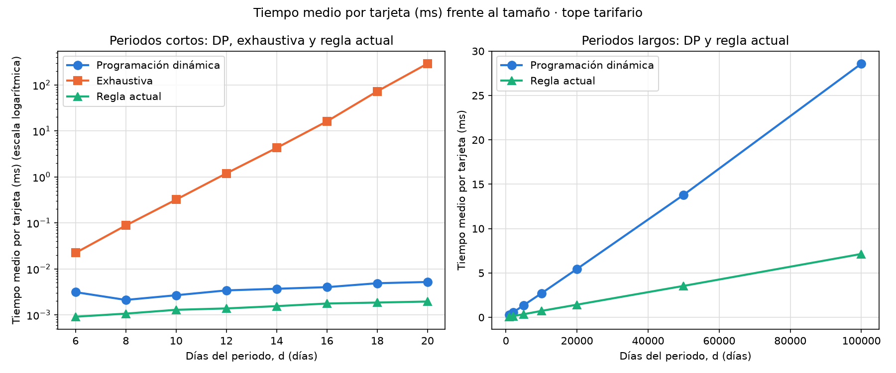
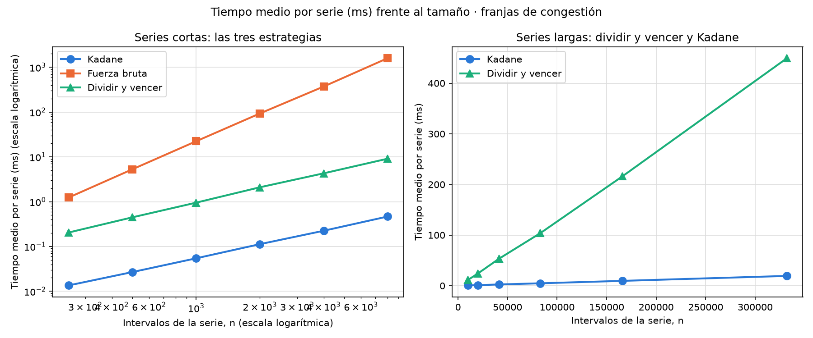
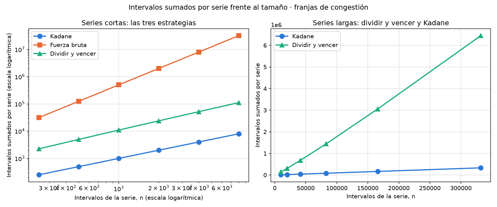

# Conciliación nocturna del recaudo del SITVM

**Análisis de Algoritmos · 2026-2 · Proyecto final · Caso de estudio 1**

**Integrantes:**
- Sebastián Jesús Pérez Araujo · sebastianperez1116036@correo.itm.edu.co ([@SESASAN](https://github.com/SESASAN))
- Geremy Santa Duque · geremysanta1117442@correo.itm.edu.co ([@GereSanta07](https://github.com/GereSanta07))
- Nathalie Gabriela Miranda Rejón · nathaliemiranda1117738@correo.itm.edu.co ([@NathyGaby04](https://github.com/NathyGaby04))
- Samuel Quiroz Rincón · samuelquiroz1113937@correo.itm.edu.co ([@Samuzarter](https://github.com/Samuzarter))

**Operaciones abordadas:**
- Operación 4: liquidación del tope tarifario (Laboratorio 4, programación dinámica)
- Operación 3: detección de las franjas de congestión (entrega del 23 de noviembre)

---

## 1. Análisis del problema

### 1.1 Descripción del problema computacional

El Sistema Integrado de Transporte del Valle Metropolitano (SITVM) procesa cada noche, en un proceso por lotes, las validaciones de los usuarios en el metro, las líneas de cable y los buses alimentadores, para preparar la información de las áreas de Recaudo, Atención al Usuario y Planeación. El proceso tiene cuatro operaciones: eliminar las validaciones duplicadas, ordenar los registros por tarjeta y fecha, identificar las franjas de mayor congestión en las estaciones y calcular el costo mínimo que debe pagar cada usuario según los productos tarifarios.

Hoy el proceso tarda más de ocho horas, pero solo dispone de cuatro, entre las 00:00 y las 04:00. A las 04:30 abren las estaciones y los validadores necesitan la información actualizada, en especial las listas de tarjetas robadas o extraviadas. Parte de la demora viene de las estrategias actuales: la deduplicación compara cada validación con todas las ya aceptadas, el ordenamiento usa inserción, la detección de congestión evalúa todos los tramos consecutivos posibles y la liquidación del tope explora combinaciones de productos, recurriendo a una regla simplificada cuando resulta demasiado costoso.

El problema consiste en diseñar e implementar estrategias algorítmicas que mejoren el rendimiento de las operaciones seleccionadas, manteniendo la exactitud de los resultados y las restricciones del sistema, para que el procesamiento quepa en la ventana nocturna sin perder validaciones ni afectar los cobros.

### 1.2 Entradas, salidas y restricciones

#### Operación 4 · Tope tarifario

Al cierre de cada mes, el sistema revisa cada tarjeta personalizada para que lo cobrado no supere la combinación más económica de pasajes y pases que cubra todos sus viajes; si lo supera, la diferencia se devuelve como saldo a favor. El problema se modela sobre una tarjeta y un mes.

**Entradas:**

- **`viajes_por_dia`:** lista de enteros no negativos con los viajes de cada día; la posición 0 es el día 1. Su longitud `d` es el número de días del mes (28 a 31).
- **`cobrado`:** valor en pesos descontado durante el mes; solo se usa para calcular la devolución.
- **Tarifas del perfil general:**

| Producto | Valor | Cobertura |
|---|---:|---|
| Pasaje sencillo | $3.900 | Un viaje |
| Pase diario | $9.500 | Viajes ilimitados durante un día calendario |
| Pase semanal | $36.000 | Viajes ilimitados durante 7 días consecutivos |
| Pase mensual | $135.000 | Viajes ilimitados durante 30 días consecutivos |

**Salidas:** el **costo mínimo** de la combinación más económica que cubre todos los viajes (`costo_minimo`) y la **devolución**, `cobrado − mínimo`, que nunca es negativa: si se cobró el mínimo o menos, es 0 (`liquidar_tope`).

**Restricciones:**

- **Devolución exacta:** ni más ni menos de lo que corresponde, así que no se permiten aproximaciones y todo se maneja en pesos enteros.
- **Cobertura completa:** la combinación debe cubrir todos los días con viajes; un semanal o mensual cubre días consecutivos desde el día de compra.
- **Volumen y ventana:** unas 950.000 tarjetas deben liquidarse la noche del cierre, dentro de la ventana de 4 horas que se comparte con las operaciones 1 y 2.
- **Infraestructura:** un único servidor de unos 500 W, sin procesamiento paralelo ni distribuido.

#### Operación 3 · Franjas de congestión

Para cada estación se busca el tramo consecutivo de mayor congestión a partir del saldo neto de pasajeros registrado cada cinco minutos: los que entran a la plataforma menos los que los trenes evacuan. El resultado muestra los periodos de mayor acumulación.

**Entradas:**

- **`saldos`:** lista de enteros con el saldo neto de una estación por intervalo de cinco minutos; cada valor puede ser positivo, negativo o cero.
- **Volumen:** 80 estaciones, cada una procesada de forma independiente, con un histórico de dos años de unos 166.000 intervalos (unos 228 intervalos por día de operación).

**Salidas:** la tupla `(inicio, fin, suma)`, donde `inicio` y `fin` son los índices del primer y último intervalo del tramo (desde 0 e inclusivos) y `suma` es el saldo acumulado, el mayor de toda la serie.

**Restricciones:**

- **Continuidad:** el tramo está formado por intervalos consecutivos, sin saltar posiciones.
- **Resultado exacto:** se debe encontrar la suma máxima, sin aproximaciones.
- **Valores negativos:** la estrategia debe funcionar cuando hay periodos en que se evacuan más pasajeros de los que entran, incluso si todos los saldos son negativos.
- **Tamaño:** con unos 166.000 intervalos por estación, evaluar todos los tramos posibles se vuelve muy costoso.
- **Infraestructura:** el mismo servidor de unos 500 W, sin procesamiento paralelo ni distribuido.

### 1.3 Operaciones críticas del proceso

Con los datos del caso (1.400.000 validaciones diarias, 950.000 tarjetas al mes y 80 estaciones con 166.000 intervalos cada una), el trabajo de cada operación con su estrategia actual es:

| Operación | Estrategia actual | Complejidad | Frecuencia | Trabajo aproximado por ejecución | ¿Dentro de la ventana? |
|---|---|---|---|---|---|
| 1 · Deduplicación | Compara cada validación con todas las ya aceptadas | Θ(n²) | Todas las noches | n²/2 ≈ 9,8 × 10¹¹ comparaciones | Debe caber en 4 h |
| 2 · Ordenamiento | Inserción | Θ(n²) en el caso promedio | Todas las noches | n²/4 ≈ 4,9 × 10¹¹ movimientos | Debe caber en 4 h |
| 3 · Franjas de congestión | Evalúa todos los tramos | Θ(n²) por estación | Cuando Planeación lo requiere | ≈ 1,1 × 10¹² sumas para las 80 estaciones | Hoy no termina; se usa una muestra |
| 4 · Tope tarifario | Exhaustiva más regla simplificada | Exponencial en los días con viaje | Cierre de mes | Más de 2^31 llamadas para una tarjeta que viaja todo el mes | Solo cabe gracias a la regla, que cobra de más |

Las operaciones 1 y 2 son las que más pesan en la ventana, porque corren todas las noches con el volumen completo y hacen entre 10¹¹ y 10¹² pasos cada una. La operación 3 tiene un crecimiento similar sobre el histórico, por lo que hoy no puede ejecutarse sobre toda la red y Planeación trabaja con una muestra. La operación 4 tiene el crecimiento más alto, exponencial, y el proceso actual lo evita con una regla simplificada que puede cobrar de más.

Este proyecto se enfoca en las operaciones 4, que necesita calcular el tope exacto sin cobros de más, y 3, que necesita analizar todas las estaciones en un tiempo razonable. Las operaciones 1 y 2 quedan como recomendación para una siguiente fase (5.2).

### 1.4 Costo energético del proceso actual (línea base)

La energía se calcula con **kWh = kW × h**, con el servidor de 0,5 kW del caso, el tiempo del proceso nocturno que reporta el cliente y, para las operaciones 3 y 4, los tiempos medidos en 4.1 y 4.2.

| Componente | Tiempo | Energía por ejecución | Frecuencia | Energía por año |
|---|---:|---:|---|---:|
| Proceso nocturno actual (reportado por el cliente) | Más de 8 h | Más de 4 kWh | 365 noches | Más de 1.460 kWh |
| Operación 3, fuerza bruta sobre las 80 estaciones (estimada) | ≈ 15,2 h | ≈ 7,6 kWh | Una vez por noche, si se analizara toda la red | ≈ 2.776 kWh |
| Operación 4, regla simplificada (medida) | ≈ 2,5 s | ≈ 0,0003 kWh | 12 cierres | ≈ 0,004 kWh |

- **Proceso nocturno:** más de 4 kWh por noche y más de 1.460 kWh al año. Es un mínimo, porque solo se sabe que el proceso supera las 8 horas.
- **Operación 3:** hoy no se ejecuta sobre toda la red. Con fuerza bruta, cada ejecución consumiría unos 7,6 kWh y, una vez por noche, unos 2.776 kWh al año, casi el doble de todo el proceso nocturno actual.
- **Operación 4:** la regla simplificada consume muy poco. La exhaustiva completa no se cuenta como consumo actual, porque necesitaría casi 8 años por cierre (4.1).

Son estimaciones: las mediciones se hicieron en un computador de escritorio y no en el servidor del SITVM, y no incluyen la lectura de datos ni el consumo en reposo.

### 1.5 Supuestos del equipo

**Operación 4 · Tope tarifario**

- **Regla simplificada actual:** los primeros 30 días se dividen en bloques fijos (1–7, 8–14, 15–21, 22–28 y 29–30). Cada día cuesta lo menor entre pasajes y diario; cada bloque se limita al semanal ($36.000) y el acumulado de los 30 días, al mensual ($135.000). Por ejemplo, 7 días con 3 viajes cuestan $81.900 en pasajes, $66.500 con diarios y la regla cobra $36.000 por el bloque. En meses de 31 días, el día 31 se cobra aparte con el menor entre pasajes y diario.
- **Duración del mes:** el periodo es un mes calendario de 28 a 31 días, según la entrada.
- **Pases que exceden el mes:** un pase comprado al final del mes solo cubre los días que quedan, pero se paga completo, sin descuento proporcional.
- **Perfiles diferenciales:** conservan los mismos productos y reglas con otras tarifas; la implementación usa las del perfil general.
- **Datos válidos:** la entrada es una lista de enteros no negativos; una lista vacía es un periodo sin viajes.

**Operación 3 · Franjas de congestión**

- **Saldos ya calculados:** la serie de cada estación llega con el saldo neto por intervalo, sin intervalos faltantes.
- **Frecuencia:** para estimar la energía se supone una ejecución cada noche sobre las 80 estaciones (1.4 y 6.1).
- **Empates:** si varios tramos tienen la misma suma máxima, cualquiera es una respuesta válida (3.2).

**Ambas operaciones**

- **Ejecución:** en memoria, secuencial y en un solo hilo, sin almacenamiento externo.
- **Datos sintéticos:** las pruebas y mediciones usan instancias generadas con semilla fija 2026, sin información personal ni registros reales.

---

## 2. Diseño de la solución

### 2.1 Estructuras de datos seleccionadas

#### Operación 4 · Tope tarifario

| Estructura | Qué almacena | Motivo de elección |
|---|---|---|
| Lista de enteros `viajes_por_dia` | Viajes de cada día; la posición 0 es el día 1. | Es la entrada. Su longitud da los días del periodo (28 a 31), sin asumir que todos los meses tienen 30. |
| Lista `costos` de tamaño d + 2 | `costos[t]` = C(t), con `costos[d+1] = 0` como caso base. | Los estados van del día 1 al d + 1 sin huecos, así que una lista da acceso O(1); un diccionario ocuparía más memoria sin ventaja, porque se calculan todos los estados. |
| Lista `elecciones` de tamaño d + 2 | Producto elegido en cada día. | Permite reconstruir las compras y verificar que sumen exactamente C(1); sin ella solo se conocería el costo. |
| Tupla `PASES` | Nombre, precio y días de cobertura del semanal y el mensual. | Los pases se evalúan en un solo ciclo y un cambio de tarifas no toca la lógica. |
| Enteros en pesos | Todos los costos. | Evitan los errores de redondeo de `float` al calcular devoluciones. |

**Espacio:** Θ(d). Para conocer solo el costo bastaría una ventana de 31 posiciones, porque ningún pase mira más de 30 días adelante, pero se guarda la tabla completa para reconstruir las compras y auditar cada liquidación.

#### Operación 3 · Franjas de congestión

- **Lista de saldos (`list[int]`).** La serie de una estación: un saldo neto por intervalo de 5 minutos (pasajeros que entraron menos los que los trenes evacuaron), que puede ser negativo. Se recorre, pero nunca se modifica.
- **Tupla del tramo (`Tramo = tuple[int, int, int]`).** La respuesta `(inicio, fin, suma)`, con índices desde 0 e inclusivos. Es inmutable, así que un subproblema no puede alterar el resultado de otro, y ocupa espacio constante.

Dividir y vencer no copia sublistas: cada subproblema se identifica con dos enteros, `bajo` y `alto`, sobre la misma lista. Copiar `saldos[bajo:medio + 1]` en cada llamada agregaría Θ(n log n) de trabajo y Θ(n) de memoria; con índices, la memoria adicional es solo la pila, de profundidad Θ(log n), y la serie original nunca se altera.

### 2.2 Operación 4 · Tope tarifario

#### Por qué el problema admite programación dinámica

**Subestructura óptima.** El costo de una tarjeta se divide en lo que se compra el primer día con viajes pendientes y el costo mínimo de cubrir el resto del periodo, que es el mismo problema empezando en un día posterior. Para decidir solo hace falta saber desde qué día quedan viajes por pagar. Además, el resto debe resolverse de forma óptima: si se usara una solución más cara, reemplazarla por la más barata reduciría el total.

**Subproblemas que se repiten.** En el ejemplo de abajo, el estado C(8) (pagar desde el día 8 hasta el final) se alcanza por dos caminos: comprar un semanal el día 1, o pagar el pasaje del día 1 y luego cada día del 4 al 7. Lo mismo ocurre con C(9). La exhaustiva recalcula estos estados cada vez que los encuentra; la programación dinámica los calcula una vez y los reutiliza.

**Por qué no basta decidir día por día.** Un semanal o un mensual comprado el día t cubre también los días siguientes, así que elegir el precio más barato de cada día por separado no ve esas combinaciones.

#### Ejemplo resuelto a mano

**Datos de entrada:** viajes = [1, 0, 0, 2, 3, 2, 3, 3], con caso base C(9) = 0.

| Día | Viajes | Solo ese día | Semanal | Mensual | C | Gana |
|---|---|---|---|---|---|---|
| 9 | — | — | — | — | 0 | caso base |
| 8 | 3 | 9.500 + 0 = 9.500 | 36.000 + C(9) = 36.000 | 135.000 | 9.500 | diario |
| 7 | 3 | 9.500 + 9.500 = 19.000 | 36.000 | 135.000 | 19.000 | diario |
| 6 | 2 | 7.800 + 19.000 = 26.800 | 36.000 | 135.000 | 26.800 | pasajes |
| 5 | 3 | 9.500 + 26.800 = 36.300 | 36.000 | 135.000 | 36.000 | semanal |
| 4 | 2 | 7.800 + 36.000 = 43.800 | 36.000 + C(9) = 36.000 | 135.000 | 36.000 | semanal |
| 3 | 0 | se copia C(4) | | | 36.000 | — |
| 2 | 0 | se copia C(3) | | | 36.000 | — |
| 1 | 1 | 3.900 + 36.000 = 39.900 | 36.000 + C(8) = 45.500 | 135.000 | **39.900** | pasaje |

En el día 5, el semanal gana por solo $300 ($36.000 frente a $36.300 de pagar los días 5 a 8 por separado). En el día 1, el semanal sale más caro porque cubre los días 2 y 3, que no tienen viajes, y deja por fuera el día 8, que hay que pagar aparte: $36.000 + $9.500 = $45.500.

Siguiendo la opción ganadora desde el día 1, las compras son: **un pasaje el día 1 ($3.900) y un semanal el día 4 ($36.000)**, que cubre hasta el final. **Costo total: $39.900.** En esta misma instancia la regla actual cobra $45.500, $5.600 más, porque solo aplica el semanal sobre el bloque fijo de los días 1 a 7 (ver 5.1).

#### Recurrencia

```text
hoy(t) = min(viajes_t · 3.900, 9.500)

C(d+1) = 0
C(t)   = C(t+1)                                   si el día t no tiene viajes
C(t)   = mín{ hoy(t) + C(t+1),
              36.000  + C(min(t+7,  d+1)),
              135.000 + C(min(t+30, d+1)) }       si tiene viajes
```

- **C(t)** es el costo mínimo de cubrir los viajes desde el día t hasta el final, suponiendo que los días anteriores ya están pagos. El resultado es C(1), y la devolución es `max(0, cobrado − C(1))`.
- **hoy(t)** es la forma más barata de pagar solo el día t: desde 3 viajes conviene el diario, porque $11.700 > $9.500.
- **Las tres alternativas** suman el precio de la compra al costo de lo que queda sin cubrir: desde t + 1 al pagar solo el día, desde t + 7 con el semanal y desde t + 30 con el mensual.
- **El límite d + 1** lleva al caso base cuando un pase se sale del periodo, sin consultar posiciones fuera de la tabla.
- **Los días sin viajes** no compran nada y copian el costo del día siguiente.

**Orden de cálculo.** Cada estado depende de días posteriores, así que la tabla se llena de C(d + 1) hacia C(1): cuando se consulta un estado, ya está calculado.

#### Estrategias diseñadas

**Programación dinámica (propuesta)**

```text
función costo_minimo(viajes):
    d ← largo(viajes)
    costos[1..d+1] ← 0
    elecciones[1..d+1] ← "nada"

    para t desde d hasta 1:
        si viajes[t] = 0:
            costos[t] ← costos[t+1]
            continuar

        costos[t] ← hoy(t) + costos[t+1]
        elecciones[t] ← "pasajes" si viajes[t]·3900 < 9500, si no "diario"

        para cada (nombre, precio, L) en [(semanal, 36000, 7), (mensual, 135000, 30)]:
            cand ← precio + costos[min(t+L, d+1)]
            si cand < costos[t]:
                costos[t] ← cand
                elecciones[t] ← nombre

    devolver costos[1]
```

Cada día revisa como máximo tres alternativas: tiempo Θ(d) y espacio Θ(d) por las dos tablas.

**Exhaustiva (solución exacta para verificar)**

```text
función exh(viajes, t):
    si t > d: devolver 0
    si viajes[t] = 0: devolver exh(viajes, t+1)

    mejor ← viajes[t] * 3900 + exh(viajes, t+1)
    mejor ← min(mejor, 9500 + exh(viajes, t+1))
    mejor ← min(mejor, 36000 + exh(viajes, t+7))
    mejor ← min(mejor, 135000 + exh(viajes, t+30))

    devolver mejor
```

Evalúa todas las combinaciones de compra sin guardar los subproblemas. Su espacio es Θ(d), por la profundidad de la recursión; su tiempo se analiza en 4.1.

**Regla actual (línea base),** según la interpretación de 1.5:

```text
función regla_actual(viajes):
    n ← min(d, 30)
    total ← 0

    para cada bloque de 7 días dentro de 1..n:
        total ← total + min(Σ hoy(t) en el bloque, 36000)

    total ← min(total, 135000)

    para t de 31 a d:
        total ← total + hoy(t)

    devolver total
```

Su tiempo también es Θ(d): la diferencia con la programación dinámica está en el resultado, no en el costo computacional. Está pensada para un solo mes (d ≤ 31); en la serie 2 de `medicion.py` se ejecuta con periodos mayores solo para medir su tiempo, sin comparar sus cobros.

### 2.3 Operación 3 · Franjas de congestión

Se diseñaron dos estrategias exactas: dividir y vencer y Kadane. La fuerza bruta, que es la estrategia actual, se conserva como referencia para la verificación y la comparación.

#### Por qué el problema admite dividir y vencer

Si la serie se parte en `medio`, el tramo de mayor suma está en uno de tres lugares:

1. **Completamente en la mitad izquierda** (`bajo … medio`).
2. **Completamente en la mitad derecha** (`medio + 1 … alto`).
3. **Cruzando el medio:** contiene obligatoriamente a `medio` y a `medio + 1`.

Los dos primeros son el mismo problema sobre la mitad de los datos y se resuelven recursivamente. El tercero no es recursivo: es la unión del mejor sufijo de la mitad izquierda y el mejor prefijo de la derecha, y cada uno se encuentra con un recorrido lineal desde el medio hacia afuera. Como todo tramo consecutivo cae en uno de los tres casos, ninguno se omite y el resultado es el máximo exacto.

#### Recurrencia

```text
T(1) = Θ(1)
T(n) = 2·T(n/2) + Θ(n)
```

Por el teorema maestro (a = 2, b = 2, f(n) = Θ(n), caso 2), T(n) = Θ(n log n): hay log₂ n niveles de recursión y en cada uno los cruces suman, entre todos, n intervalos. El espacio adicional es Θ(log n), por la pila; para el histórico de dos años (n ≈ 166.000) son unas 18 llamadas de profundidad.

#### Pseudocódigo

```text
TRAMO-MÁXIMO(saldos, bajo, alto):
    si bajo == alto:
        devolver (bajo, alto, saldos[bajo])
    medio ← (bajo + alto) // 2
    izq   ← TRAMO-MÁXIMO(saldos, bajo, medio)
    der   ← TRAMO-MÁXIMO(saldos, medio + 1, alto)
    cruce ← TRAMO-CRUZADO(saldos, bajo, medio, alto)
    devolver el de mayor suma entre izq, der y cruce

TRAMO-CRUZADO(saldos, bajo, medio, alto):
    mejor_izq ← −∞
    inicio ← medio
    suma ← 0
    para i desde medio bajando hasta bajo:
        suma ← suma + saldos[i]
        si suma > mejor_izq:
            mejor_izq ← suma
            inicio ← i

    mejor_der ← −∞
    fin ← medio + 1
    suma ← 0
    para j desde medio + 1 hasta alto:
        suma ← suma + saldos[j]
        si suma > mejor_der:
            mejor_der ← suma
            fin ← j

    devolver (inicio, fin, mejor_izq + mejor_der)
```

#### Ejemplo resuelto a mano

Serie de 8 intervalos (índices 0 a 7): saldos = [3, −5, 4, 2, −1, 6, −8, 2]. Los rangos de un intervalo son casos base y devuelven su propio saldo.

| Rango | Medio | Izquierdo | Derecho | Cruzado | Ganador |
|---|---:|---|---|---|---|
| [0, 1] | 0 | (0, 0, 3) | (1, 1, −5) | 3 + (−5) → (0, 1, −2) | **(0, 0, 3)** |
| [2, 3] | 2 | (2, 2, 4) | (3, 3, 2) | 4 + 2 → (2, 3, 6) | **(2, 3, 6)** |
| [4, 5] | 4 | (4, 4, −1) | (5, 5, 6) | −1 + 6 → (4, 5, 5) | **(5, 5, 6)** |
| [6, 7] | 6 | (6, 6, −8) | (7, 7, 2) | −8 + 2 → (6, 7, −6) | **(7, 7, 2)** |
| [0, 3] | 1 | (0, 0, 3) | (2, 3, 6) | −2 (desde 0) + 6 (hasta 3) → (0, 3, 4) | **(2, 3, 6)** |
| [4, 7] | 5 | (5, 5, 6) | (7, 7, 2) | 6 (desde 5) + −6 (hasta 7) → (5, 7, 0) | **(5, 5, 6)** |
| [0, 7] | 3 | (2, 3, 6) | (5, 5, 6) | 6 (desde 2) + 5 (hasta 5) → **(2, 5, 11)** | **(2, 5, 11)** |

En el último nivel, el mejor sufijo izquierdo suma 6 empezando en el índice 2, y el mejor prefijo derecho suma 5 terminando en el índice 5. **Respuesta: los intervalos 2 a 5, con 4 + 2 − 1 + 6 = 11 pasajeros acumulados.** Ninguna mitad por sí sola encuentra este tramo; por eso hace falta el caso cruzado.

El contador del código suma 8 intervalos en los casos base y 8 en cada uno de los tres niveles de cruces: **32 = n(log₂ n + 1)**, frente a las **36** = n(n + 1)/2 de la fuerza bruta. Con 8 intervalos casi no hay diferencia; la ventaja aparece al crecer n.

#### Segunda estrategia: Kadane (programación dinámica)

**Por qué el problema admite programación dinámica.** Sea `M(i)` la mayor suma de un tramo que **termina** en el intervalo `i`. Ese tramo solo puede ser de dos formas: el intervalo `i` solo, o el mejor tramo que termina en `i − 1` extendido con `i`. Si se usara un tramo peor que termine en `i − 1`, reemplazarlo por el mejor daría una suma mayor (subestructura óptima). Además, cada `M(i)` se usa para calcular `M(i + 1)`, así que guardarlo evita recalcular los tramos desde cero, como hace la fuerza bruta. El tramo de mayor suma de toda la serie termina en algún intervalo, así que la respuesta es el mayor de los `M(i)`.

**Recurrencia.**

```text
M(0) = saldo₀
M(i) = max(saldoᵢ, M(i − 1) + saldoᵢ)        para i = 1, …, n − 1
respuesta = max(M(0), M(1), …, M(n − 1))
```

Si `M(i − 1)` no es positivo, sumarlo no ayuda y conviene empezar un tramo nuevo en `i`. Como `M(i)` solo depende de `M(i − 1)`, no hace falta una tabla: basta una variable con la suma actual y otra con el mejor tramo visto.

**Pseudocódigo.**

```text
TRAMO-MÁXIMO-KADANE(saldos):
    si saldos está vacía: error
    suma_actual ← 0
    inicio_actual ← 0
    mejor ← (0, 0, saldos[0])
    para i desde 0 hasta n − 1:
        si suma_actual ≤ 0:
            suma_actual ← saldos[i]
            inicio_actual ← i
        si no:
            suma_actual ← suma_actual + saldos[i]
        si suma_actual > mejor.suma:
            mejor ← (inicio_actual, i, suma_actual)
    devolver mejor
```

Hace una suma por intervalo: tiempo Θ(n) y espacio adicional Θ(1). Con la serie del ejemplo anterior:

| `i` | 0 | 1 | 2 | 3 | 4 | 5 | 6 | 7 |
|---|---|---|---|---|---|---|---|---|
| Saldo | 3 | −5 | 4 | 2 | −1 | 6 | −8 | 2 |
| `M(i)` | 3 | −2 | **4** (empieza de nuevo) | 6 | 5 | **11** | 3 | 5 |

En el índice 2 la suma acumulada era −2, así que Kadane descarta lo anterior y empieza en 2. Llega al mismo tramo que dividir y vencer, **(2, 5, 11)**, con solo 8 sumas frente a 32.

#### Cómo reduce el consumo energético frente a la fuerza bruta

Con el servidor a una potencia casi constante de 500 W, la energía es E = P × t, así que reducir el tiempo reduce el consumo. Para el histórico de dos años de una estación (n ≈ 166.000), la fuerza bruta hace unos 1,38 × 10¹⁰ sumas; dividir y vencer, unos 3,06 × 10⁶ (**unas 4.500 veces menos**), y Kadane, 166.000 (**unas 83.000 veces menos**). La diferencia crece con la serie: si el histórico se duplica, la fuerza bruta cuadruplica su trabajo, dividir y vencer lo multiplica por poco más de 2 y Kadane exactamente por 2. Los tiempos y la energía medidos se presentan en 4.2 y 6.1.

---

## 3. Implementación

### 3.1 Operación 4 · Tope tarifario

Código en [`src/tope_tarifario/`](src/tope_tarifario/):

| Módulo | Contenido |
|---|---|
| [`estrategia.py`](src/tope_tarifario/estrategia.py) | `costo_minimo` (programación dinámica) y `liquidar_tope` |
| [`exhaustivo.py`](src/tope_tarifario/exhaustivo.py) | `costo_exhaustivo`, que prueba todas las combinaciones |
| [`regla_actual.py`](src/tope_tarifario/regla_actual.py) | `costo_regla_actual`, la regla simplificada de hoy |
| [`datos.py`](src/tope_tarifario/datos.py) | Generador de meses sintéticos con semilla fija |
| [`pruebas.py`](src/tope_tarifario/pruebas.py) | Pruebas con `assert` |
| [`medicion.py`](src/tope_tarifario/medicion.py) | Experimentos y gráficas |

#### Decisiones de implementación de `estrategia.py`

1. **Tabla calculada con un ciclo, sin recursión.** Python tiene un límite de profundidad para las llamadas recursivas, y cada llamada también agrega un costo. Por eso se utiliza un ciclo `for t in range(d, 0, -1)`, que deja claro el orden de cálculo y permite medir periodos de cientos de miles de días.

2. **Listas indexadas desde 1 hasta d + 1.** De esta forma, el código sigue la misma numeración que la recurrencia: `costos[d+1] = 0` queda establecida desde la inicialización y `min(t + dias, d + 1)` evita acceder a posiciones que no existen cuando un pase se sale del periodo.

3. **Precios y duraciones definidos como datos.** Los precios se encuentran en las constantes `PASAJE`, `DIARIO`, `SEMANAL` y `MENSUAL`. Los pases de varios días se organizan en la tupla `PASES`, que almacena su nombre, precio y duración. También existe el diccionario `DURACION`, utilizado para reconstruir las compras. Así, los valores se mantienen separados de la lógica principal.

4. **Desempate mediante comparación estricta.** Se utiliza `<` al comparar los costos. Si dos alternativas tienen el mismo precio, se conserva la que se evaluó primero. Por ejemplo, para `[3] * 31`, comprar el diario el día 1 y el mensual el día 2 cuesta lo mismo que comprar el mensual el día 1 y el diario el día 31: $144.500. Sin embargo, gana la primera combinación porque se evalúa antes. Esto no modifica el costo mínimo, pero sí determina qué compras aparecen en la reconstrucción.

5. **Separación del costo y la reconstrucción.** La función `costo_minimo` devuelve únicamente el valor entero que solicita el esqueleto. Las compras se recuperan utilizando `reconstruir_compras`, que sigue las elecciones guardadas y salta los días cubiertos por cada pase. Las pruebas comprueban que las compras cubran todos los viajes y sumen exactamente C(1).

6. **Cálculo de la devolución.** `liquidar_tope` utiliza la expresión `max(0, cobrado - costo_minimo(viajes))`, garantizando que el valor devuelto nunca sea negativo.

7. **Contador de operaciones y reutilización de la recurrencia.** Las funciones `costo_minimo` y `costo_minimo_contando` utilizan `_llenar_tablas`, que contiene la única implementación de la recurrencia. Así se evita duplicar la lógica. El contador registra una operación por cada día sin viajes y tres por cada día con viajes, correspondientes a las alternativas evaluadas. Por esta razón, la función `costo_minimo` también realiza el conteo, aunque no devuelva ese valor. Este trabajo adicional consiste en incrementar un entero por día y se mantiene dentro de Θ(d).

#### Decisiones de implementación de `exhaustivo.py` y `regla_actual.py`

1. **Solución exhaustiva mediante recursividad.** Se implementó `costo_exhaustivo` evaluando las cuatro alternativas disponibles: pasajes sencillos, pase diario, pase semanal y pase mensual. Claramente para cada alternativa se realiza el calculo de su costo y se continúa desde el primer día que todavía falta por cubrir. Finalmente, se selecciona el menor de los cuatro resultados. Cabe resaltar que no se utiliza ninguna técnica de optimización, ni se almacenan resultados anteriores, porque el propósito es probar todas las combinaciones posibles y utilizar esta solución como referencia para verificar la programación dinámica.

2. **Tratamiento de días sin viajes.** Cuando un día no registra viajes, la función continúa directamente al siguiente día sin realizar ninguna compra. Lo anterior evita considerar productos innecesarios.

3. **Límites de cobertura.** Cuando un pase supera la duración del periodo, se limita el siguiente estado al último día disponible más uno. De esta manera, no se realizan accesos fuera del periodo.

4. **Implementación de la regla actual.** `costo_regla_actual` calcula primero el costo diario más económico entre los pasajes sencillos y el pase diario. Después aplica los topes semanales sobre los bloques fijos establecidos en el README (días 1–7, 8–14, 15–21, 22–28 y 29–30), seguido del tope mensual de $135.000. Si existe un día 31, se cobra por separado.

5. **Uso de las mismas tarifas.** Ambos módulos importan las constantes de `estrategia.py`, evitando duplicar los precios de los productos y manteniendo una única referencia para las tarifas.

### 3.2 Operación 3 · Franjas de congestión

#### Decisiones de implementación de `dividir_y_vencer.py`

- **Índices en vez de copias.** Las funciones recursivas reciben la lista original y el rango `[bajo, alto]`. No se usa *slicing*, así que no se gasta Θ(n log n) en copias, la memoria adicional es solo la pila (Θ(log n)) y la serie original no se toca.
- **Contrato común entre estrategias.** Todas las estrategias de la operación 3 devuelven `(inicio, fin, suma)` con índices desde 0 e inclusivos, de modo que `suma == sum(saldos[inicio:fin + 1])`. Si todos los saldos son negativos, la respuesta es el intervalo menos negativo, y no un tramo vacío con suma 0, porque Planeación necesita un tramo real. Ante empates, cualquier tramo con la suma máxima es válido. Gracias a este contrato, las estrategias pueden compararse de la misma forma, verificando que las sumas coincidan y que cada tramo devuelto efectivamente sume lo que dice.
- **`ValueError` con la serie vacía.** Una serie sin intervalos no tiene ningún tramo que cumpla el contrato. Devolver `(0, -1, 0)` o `None` sería inventar una respuesta que el llamador podría usar sin darse cuenta. Fallar de forma explícita obliga a tratar ese caso donde se origina.
- **Contador de operaciones.** La operación elemental es cada intervalo sumado: el caso base suma uno y cada cruce suma una vez todos los intervalos de su rango. El contador es una lista de un elemento (`[0]`) que se pasa por la recursión; al ser mutable, todas las llamadas acumulan sobre el mismo valor sin variables globales. Para n potencia de 2, el total es exactamente n(log₂ n + 1), lo que permite contrastar lo medido con la teoría.
- **Función compartida.** La lógica vive en un solo lugar: `tramo_maximo_dyv` delega en `tramo_maximo_dyv_contando` y descarta el contador. Así, el código que se mide es exactamente el mismo que se usa, y no hay dos versiones que puedan desincronizarse. El costo de llevar el contador es una suma por llamada, despreciable frente al recorrido del cruce.


### 3.3 Tecnologías y herramientas

Para el desarrollo del proyecto se utilizaron las siguientes herramientas y bibliotecas:

| Herramienta | Uso en el proyecto |
|---|---|
| Python 3.13 o superior | Lenguaje utilizado para implementar las estrategias, desarrollar las pruebas y realizar las mediciones. |
| `random` (biblioteca estándar) | Generación de instancias sintéticas en [`datos.py`](src/tope_tarifario/datos.py). Se utiliza un generador `random.Random` con una semilla fija para garantizar que los datos sean reproducibles. |
| `time` (biblioteca estándar) | Medición de los tiempos de ejecución mediante `time.perf_counter()`, implementada en [`medicion.py`](src/tope_tarifario/medicion.py). |
| `matplotlib` | Generación de las gráficas de tiempo y número de operaciones frente al tamaño de la entrada. Es la única dependencia externa del proyecto. |
| Entorno virtual (`venv`) | Aislamiento de las dependencias del proyecto para evitar conflictos con otros entornos de Python. La carpeta `.venv/` se excluye del repositorio. |
| `requirements.txt` | Archivo que registra las dependencias necesarias para instalar y reproducir el entorno mediante `pip install -r requirements.txt` (8). |
| Git y GitHub | Control de versiones y trabajo colaborativo. Cada integrante trabaja en ramas `feature/<nombre>` creadas a partir de `development`, y los cambios se integran en esta última. La rama `main` conserva la versión estable del proyecto. El archivo `.gitignore` excluye elementos como `.venv/`, `__pycache__/` y archivos de configuración de los editores. |

Las estrategias, la solución exhaustiva y la regla actual se implementaron manualmente, sin utilizar bibliotecas de optimización ni herramientas externas que resuelvan el problema, de acuerdo con los requisitos del laboratorio. Además, el código sigue las convenciones de PEP 8 e incluye anotaciones de tipos (*type hints*) y documentación de funciones mediante *docstrings* con formato Google Style.

---

## 4. Evaluación del desempeño

### 4.1 Operación 4 · Tope tarifario

#### Complejidad temporal y espacial

Se usa `d` para el número de días del periodo y `k` para los días con viajes (`k ≤ d`).

- **Programación dinámica (`estrategia.py`).** Recorre los días una sola vez: un día sin viajes copia `C(t + 1)` y un día con viajes compara tres opciones en Θ(1). El contador registra `T(d) = (d − k) + 3k`, así que `d ≤ T(d) ≤ 3d` y el tiempo es **Θ(d)**. El espacio adicional es Θ(d), por las listas `costos` y `elecciones` (2.1).
- **Exhaustiva (`exhaustivo.py`).** No guarda los subproblemas y en cada día con viajes abre cuatro caminos: pasajes o diario (avanzan a `t + 1`), semanal (`t + 7`) o mensual (`t + 30`). Con viajes todos los días, `T(d) = 2T(d − 1) + T(d − 7) + T(d − 30) + Θ(1) ≥ 2T(d − 1)`, así que cada día con viajes al menos duplica el trabajo y `T(d) ∈ Ω(2^d)`. En un mes de 31 días con viajes diarios supera los 2.100 millones de llamadas por tarjeta. El espacio es Θ(d), por la pila de recursión.
- **Regla actual (`regla_actual.py`).** Procesa cada día una vez dentro de su bloque: tiempo **Θ(d)** y espacio Θ(1).

| Estrategia | Tiempo | Espacio adicional | ¿Resultado exacto? |
|---|---|---|---|
| Programación dinámica | Θ(d) | Θ(d) | Sí |
| Exhaustiva | Ω(2^k), exponencial en los días con viajes | Θ(d) (pila de recursión) | Sí |
| Regla actual | Θ(d) | Θ(1) | No (ver 5.1) |

La programación dinámica y la regla actual tienen el mismo orden, Θ(d): en un mes de 31 días la DP hace como máximo `3 · 31 = 93` operaciones. Encontrar el mínimo no empeora la complejidad; solo mejora el resultado.

#### Verificación

[`pruebas.py`](src/tope_tarifario/pruebas.py) usa la solución exhaustiva como referencia para la programación dinámica, con instancias generadas en [`datos.py`](src/tope_tarifario/datos.py) con la semilla fija 2026. Se ejecuta con `python src/tope_tarifario/pruebas.py`.

| Grupo | Qué verifica |
|---|---|
| Casos límite | Periodo vacío, días sin viajes, un día con 1, 2, 3 y 10 viajes, meses de 28 a 31 días y un semanal que se sale del mes. Cubren los puntos donde cambia la mejor decisión: con 3 viajes en un día conviene el diario, con 4 días de 3 viajes el semanal, y un mes de 31 días cuesta $135.000 + $9.500 = $144.500 (1.5). |
| Ejemplo a mano | La tabla de 2.2 fila por fila, las elecciones y las compras reconstruidas. |
| Instancias aleatorias | 160 instancias en las que la DP y la exhaustiva coinciden: 120 periodos de 1 a 12 días y 40 meses de 28 a 31 días. |
| Devolución exacta | Que la devolución sea exactamente `cobrado − mínimo` y nunca negativa, con valores a mano y 30 tarjetas aleatorias. |
| Contraejemplo | Que la regla actual cobre $45.500 frente a los $39.900 del óptimo (5.1). |

En cada instancia también se comprueba que las compras reconstruidas cubran todos los viajes y sumen exactamente `C(1)` (recalculadas sin consultar la tabla), que la regla actual nunca cobre menos que el mínimo y que la entrada no se modifique. **Todas las pruebas pasan.**

**Limitación.** La exhaustiva usa el mismo modelo que la DP, así que detecta errores de índices, orden de llenado y reconstrucción, pero no un error del modelo, como una duración mal definida de un pase. Ese riesgo lo cubren el ejemplo a mano y los casos límite, calculados independientemente del código.

#### Diseño de los experimentos

Los experimentos están en [`medicion.py`](src/tope_tarifario/medicion.py), con la semilla 2026. En cada tamaño, las tarjetas se generan una vez y las soluciones se miden sobre los mismos datos. Cada día tiene viajes (entre 1 y 4) con probabilidad 0,9. Los tamaños distintos de 28 a 31 días son sintéticos: sirven para ver el crecimiento, no representan meses reales.

| Serie | Tamaños `d` (días) | Tarjetas por tamaño | Soluciones | Propósito |
|---|---|---:|---|---|
| 1 · Periodos cortos | 6 a 20 (de 2 en 2) | 5 | DP, exhaustiva y regla actual | Comparar las tres mientras la exhaustiva todavía termina |
| 2 · Periodos largos | 1.000 a 100.000 | 3 | DP y regla actual | Observar el crecimiento con tamaños grandes |
| 3 · Volumen real | 30 | 2.000 | DP y regla actual | Medir el tiempo por tarjeta para la extrapolación |

Cada tamaño se ejecutó 5 veces y se promedió el tiempo por tarjeta con `time.perf_counter()`. Antes de medir la serie 1, un `assert` comprueba que la DP y la exhaustiva den el mismo costo, y cada solución tiene un contador de operaciones (`_contando`). La exhaustiva llegó hasta `d = 20`, donde ya tarda 0,29 s por tarjeta. Equipo: AMD Ryzen 5 7600X, 32 GB de RAM DDR5 a 4800 MHz y Python 3.13.7, en un solo hilo; todo el experimento tarda menos de 30 segundos.

#### Resultados




En el panel izquierdo (eje `y` logarítmico), la exhaustiva forma una recta ascendente, señal de crecimiento exponencial, mientras la DP y la regla actual quedan casi planas. En el panel derecho (escala lineal), el tiempo y las operaciones de la DP y la regla crecen en proporción a `d`.

| `d` | DP (ms) | Exhaustiva (ms) | Regla actual (ms) | Operaciones DP | Operaciones exhaustiva | Operaciones regla |
|---:|---:|---:|---:|---:|---:|---:|
| 6 | 0,0031 | 0,022 | 0,0009 | 17 | 218 | 6 |
| 10 | 0,0027 | 0,321 | 0,0013 | 28 | 2.846 | 10 |
| 16 | 0,0040 | 16,144 | 0,0018 | 46 | 158.031 | 16 |
| 20 | 0,0052 | 290,197 | 0,0019 | 58 | 2.813.425 | 20 |
| 10.000 | 2,707 | — | 0,726 | 28.019 | — | 10.000 |
| 100.000 | 28,589 | — | 7,146 | 280.090 | — | 100.000 |

#### Lo medido contra lo esperado

| Pareja | Solución | Factor de tiempo | Factor de operaciones | Factor esperado |
|---|---|---:|---:|---:|
| 10 → 20 | Exhaustiva | ×905 | ×989 | ≈ 2^10 = 1.024 |
| 10 → 20 | DP | ×1,94 | ×2,04 | 2 |
| 10.000 → 20.000 | DP | ×2,02 | ×2,00 | 2 |
| 10.000 → 20.000 | Regla actual | ×1,97 | ×2,00 | 2 |
| 50.000 → 100.000 | DP | ×2,07 | ×2,00 | 2 |

- **DP y regla actual:** al duplicar `d`, las operaciones se duplican y el tiempo crece entre 1,9 y 2,1 veces, como corresponde a Θ(d). La DP hace unas 2,8 operaciones por día (3 en el 90 % de días con viajes y 1 en los demás), dentro de `d ≤ T(d) ≤ 3d`. En tamaños muy pequeños el tiempo fijo de llamar a las funciones pesa más y aparecen factores irregulares, como ×1,09 de 6 a 12 días; el contador no tiene ese problema.
- **Exhaustiva:** de 10 a 20 días, las operaciones crecen ×989 y el tiempo ×905, cerca del ×1.024 de `2^10`. Queda un poco por debajo porque el 10 % de los días no tiene viajes. Es una observación experimental: la recurrencia solo garantiza que el trabajo está entre Ω(2^d) y O(4^d).
- **DP frente a regla actual:** ambas son lineales, pero la DP tarda unas 4 veces más por día (28,6 ms frente a 7,1 ms con `d = 100.000`), porque evalúa tres opciones y llena dos tablas. Es una diferencia de constante, no de complejidad.

#### Extrapolación al volumen real

El cierre se estima multiplicando el tiempo por tarjeta por las 950.000 tarjetas, ya que cada una se liquida de forma independiente. Para la DP y la regla actual no hace falta extrapolar `d`, porque se midió directamente un periodo de 30 días (serie 3). La exhaustiva no se pudo medir en 30 días; entre `d = 10` y `d = 20` su tiempo crece cerca de ×1,975 por cada día, así que `t(30) ≈ 0,290 s · 1,975^10 ≈ 262 s` por tarjeta. Una regla de tres lineal no serviría, porque el crecimiento es exponencial.

| Solución | Tiempo por tarjeta (d = 30) | Tiempo para 950.000 tarjetas | ¿Cabe en la ventana de 4 h? |
|---|---:|---:|---|
| Programación dinámica | 7,0 µs | ≈ 6,7 s | Sí |
| Regla actual | 2,6 µs | ≈ 2,5 s | Sí |
| Exhaustiva (estimada) | ≈ 262 s | ≈ 69.300 h (≈ 8 años) | No |

La DP liquida todas las tarjetas en menos de 10 segundos, menos del 0,1 % de la ventana que además comparte con las operaciones 1 y 2. La exhaustiva necesitaría unos 8 años por cierre. Estas cifras dependen del equipo de medición, que no es el servidor del SITVM, y de la distribución de viajes de las tarjetas sintéticas; la cifra de la exhaustiva supone además que el factor de 1,975 por día se mantiene hasta 30 días.

### 4.2 Operación 3 · Franjas de congestión

#### Complejidad temporal y espacial

Se usa `n` para el número de intervalos de la serie de una estación. Las tres estrategias cuentan la misma operación elemental, cada intervalo sumado, para que sus contadores se puedan comparar.

- **Fuerza bruta (`fuerza_bruta.py`).** Para cada inicio recorre todos los finales acumulando la suma, sin recalcular el tramo desde cero. El tramo que empieza en `i` requiere `n − i` sumas, así que `T(n) = n(n + 1)/2 ∈ Θ(n²)`. El espacio adicional es Θ(1).
- **Dividir y vencer (`dividir_y_vencer.py`).** Su recurrencia `T(n) = 2T(n/2) + Θ(n)` da **Θ(n log n)** por el teorema maestro (2.3). El contador lo confirma: para `n` potencia de 2 suma exactamente `n(log₂ n + 1)` intervalos, `n` por cada uno de los `log₂ n + 1` niveles. El espacio es Θ(log n), por la pila, porque trabaja con índices y no copia sublistas.
- **Kadane (`kadane.py`).** Su recurrencia `M(i) = max(saldoᵢ, M(i − 1) + saldoᵢ)` (2.3) se recorre una sola vez, con una suma por intervalo: `T(n) = n`, tiempo **Θ(n)**. Como cada `M(i)` solo depende de `M(i − 1)`, guarda dos variables en lugar de una tabla: espacio **Θ(1)**.

| Estrategia | Tiempo | Espacio adicional | Sumas para el ejemplo (`n = 8`) | Sumas por estación (`n ≈ 166.000`) |
|---|---|---|---:|---:|
| Fuerza bruta | Θ(n²) | Θ(1) | 36 | ≈ 1,38 × 10¹⁰ |
| Dividir y vencer | Θ(n log n) | Θ(log n) | 32 | ≈ 3,06 × 10⁶ |
| Kadane | Θ(n) | Θ(1) | 8 | 166.000 |

Las tres son exactas; cambia su crecimiento. Para el histórico de dos años de una estación, Kadane hace unas 83.000 veces menos sumas que la fuerza bruta y 18 veces menos que dividir y vencer.

#### Verificación

[`pruebas.py`](src/congestion/pruebas.py) usa como referencia `mayor_suma_directa`, que suma cada tramo desde cero con `sum`. No comparte lógica con ninguna estrategia, aunque su costo Θ(n³) la limita a series pequeñas. Las series se generan en [`datos.py`](src/congestion/datos.py) con saldos entre −60 y 60 y la semilla 2026. Se ejecuta con `python src/congestion/pruebas.py`.

| Grupo | Qué verifica |
|---|---|
| Casos límite | Serie vacía (las tres lanzan `ValueError`), un intervalo, todos positivos (`[2, 5, 1]` → `(0, 2, 8)`), todos negativos (`[−4, −2, −7, −1, −9]` → `(3, 3, −1)`, nunca un tramo vacío de suma 0), ceros y empates. |
| Ejemplo a mano | Que las tres estrategias devuelvan `(2, 5, 11)` en el ejemplo de 2.3. |
| Series aleatorias | 200 series, 5 por cada tamaño de 1 a 40 intervalos. |
| Contadores | Que la fuerza bruta sume `n(n + 1)/2` intervalos, Kadane `n` y dividir y vencer `n(log₂ n + 1)` para potencias de 2 hasta 256. |

En cada serie se comprueba, para las tres estrategias, la restricción del negocio: que la suma devuelta sea la mayor que calcula el juez (ningún tramo acumula más pasajeros), que el tramo sea válido y sume exactamente lo reportado, que la variante `_contando` devuelva el mismo tramo que la oficial y que la entrada no se modifique. Cuando hay empates, cualquier tramo de suma máxima es válido (3.2), así que se compara la suma y se valida el tramo en lugar de exigir los mismos índices. **Todas las pruebas pasan.**

**Limitación.** Las series aleatorias llegan a 40 intervalos porque el juez es cúbico; para series largas, la medición comprueba que las estrategias coincidan. Además, los saldos sintéticos son uniformes y no reproducen las horas pico: eso no afecta la exactitud, pero sí el tramo que se encuentra.

#### Diseño de los experimentos

Los experimentos están en [`medicion.py`](src/congestion/medicion.py), con saldos entre −60 y 60 y la semilla 2026. En cada tamaño las series se generan una vez y todas las estrategias trabajan con los mismos datos.

| Serie | Tamaños `n` (intervalos) | Series por tamaño | Estrategias | Propósito |
|---|---|---:|---|---|
| 1 · Series cortas | 250 a 8.000 (duplicando) | 3 | Fuerza bruta, dividir y vencer y Kadane | Comparar las tres mientras la fuerza bruta todavía termina |
| 2 · Series largas | 10.000, 20.000, 41.500, 83.000, 166.000 y 332.000 | 3 | Dividir y vencer y Kadane | Llegar al histórico de dos años (166.000) y a su doble |

Cada tamaño se ejecutó 3 veces y se promedió el tiempo por serie con `time.perf_counter()`. Antes de medir, un `assert` comprueba que todas las estrategias obtengan la misma suma, también en 166.000 y 332.000 intervalos. La fuerza bruta llegó hasta `n = 8.000`, donde ya tarda 1,6 s por serie. Se usó el mismo equipo de la operación 4; todo el experimento tarda cerca de un minuto.

#### Resultados





En el panel izquierdo (escala logarítmica en ambos ejes), la pendiente de la fuerza bruta es cerca del doble de la de Kadane, lo que corresponde a n² frente a n, y dividir y vencer queda un poco por encima de Kadane. En el panel derecho (escala lineal), Kadane crece en línea recta y dividir y vencer un poco más rápido, por el factor log n.

| `n` | Kadane (ms) | Fuerza bruta (ms) | Dividir y vencer (ms) | Sumas Kadane | Sumas fuerza bruta | Sumas DyV |
|---:|---:|---:|---:|---:|---:|---:|
| 250 | 0,014 | 1,24 | 0,20 | 250 | 31.375 | 2.244 |
| 1.000 | 0,055 | 22,3 | 0,95 | 1.000 | 500.500 | 10.976 |
| 8.000 | 0,466 | 1.590,0 | 9,09 | 8.000 | 32.004.000 | 111.808 |
| 41.500 | 2,51 | — | 53,5 | 41.500 | — | 681.464 |
| 166.000 | 9,62 | — | 216,1 | 166.000 | — | 3.057.856 |
| 332.000 | 19,37 | — | 449,3 | 332.000 | — | 6.447.712 |

Con 8.000 intervalos, Kadane es unas 3.400 veces más rápido que la fuerza bruta. Con el histórico de dos años procesa una estación en menos de 10 ms, frente a unos 0,22 s de dividir y vencer.

#### Lo medido contra lo esperado

Para dividir y vencer, el factor esperado al duplicar `n` es algo mayor que 2, porque se agrega un nivel de recursión: `2(log₂ 2n + 1) / (log₂ n + 1)`.

| Pareja | Estrategia | Factor de tiempo | Factor de operaciones | Factor esperado |
|---|---|---:|---:|---:|
| 4.000 → 8.000 | Fuerza bruta | ×4,28 | ×4,00 | 4 |
| 4.000 → 8.000 | Dividir y vencer | ×2,12 | ×2,15 | ≈ 2,15 |
| 4.000 → 8.000 | Kadane | ×2,08 | ×2,00 | 2 |
| 166.000 → 332.000 | Dividir y vencer | ×2,08 | ×2,11 | ≈ 2,11 |
| 166.000 → 332.000 | Kadane | ×2,01 | ×2,00 | 2 |

- **Fuerza bruta:** las sumas crecen ×4 en todas las parejas y el tiempo entre ×3,99 y ×4,28, como corresponde a Θ(n²).
- **Dividir y vencer:** las sumas crecen entre ×2,11 y ×2,22, lo que predice la fórmula, y los tiempos lo siguen: crecimiento cercano al lineal, pero un poco más rápido, como Θ(n log n).
- **Kadane:** las sumas se duplican exactamente y el tiempo crece entre ×1,91 y ×2,08, como Θ(n).
- **Diferencia entre estrategias:** con 166.000 intervalos, dividir y vencer tarda unas 22 veces más que Kadane aunque solo hace 18 veces más sumas; la diferencia viene de las llamadas recursivas, que en Python tienen un costo que el contador no mide. A diferencia de la operación 4, los tiempos pequeños son estables, porque incluso con 250 intervalos el trabajo pesa más que el costo fijo de llamar a las funciones.

#### Extrapolación al volumen real

Planeación necesita el histórico de dos años de las 80 estaciones; como cada estación se procesa por separado, el tiempo total es el de una estación por 80. Kadane y dividir y vencer se midieron directamente con 166.000 intervalos. Para la fuerza bruta se escala la medición más grande siguiendo su crecimiento cuadrático: `t(166.000) ≈ 1,59 s × (166.000 / 8.000)² ≈ 685 s` por estación; una regla de tres lineal daría un valor unas 20 veces menor.

| Estrategia | Tiempo por estación (`n = 166.000`) | Tiempo para 80 estaciones | Energía por ejecución (0,5 kW) |
|---|---:|---:|---:|
| Kadane | 9,6 ms | ≈ 0,8 s | ≈ 0,0001 kWh |
| Dividir y vencer | 0,22 s | ≈ 17 s | ≈ 0,0024 kWh |
| Fuerza bruta (estimada) | ≈ 685 s (11,4 min) | ≈ 15,2 h | ≈ 7,6 kWh |

Con fuerza bruta, analizar toda la red tardaría más de 15 horas y no terminaría en una noche, lo que explica por qué hoy Planeación trabaja con una muestra. Con Kadane las 80 estaciones se procesan en menos de un segundo, y con dividir y vencer en unos 17 segundos: con cualquiera de las dos se puede analizar toda la red cada noche. Estas cifras dependen del equipo de medición y suponen que el histórico real tiene una longitud similar a la de las series sintéticas; el orden de crecimiento, en cambio, no depende del equipo.

---

## 5. Análisis comparativo

### 5.1 Operación 4 · Tope tarifario

#### Contraejemplo de la regla actual

Se utilizó la siguiente instancia para comparar el procedimiento actual con la solución óptima:

**Entrada:** `viajes = [1, 0, 0, 2, 3, 2, 3, 3]`

La instancia representa ocho días de actividad de una tarjeta, donde cada posición indica la cantidad de viajes realizados en ese día.

**Resultado de la regla actual:**

- Días 1 al 7: el costo de los viajes, aplicando el menor valor entre pasajes sencillos y pase diario, es de $38.500. Al superar el tope semanal, se cobran $36.000.
- Día 8: se realizan tres viajes, cuyo costo más económico es el pase diario de $9.500.
- Total cobrado: **$45.500**.

**Resultado de la estrategia óptima:**

La programación dinámica encuentra una combinación más económica:

- Día 1: un pasaje sencillo de $3.900.
- Días 2 y 3: no se realizan viajes.
- Día 4: un pase semanal de $36.000, que cubre hasta el día 10.

El costo mínimo es de **$39.900**.

**Comparación de resultados:**

| Método | Costo |
|---|---:|
| Regla actual | $45.500 |
| Programación dinámica | $39.900 |
| Solución exhaustiva | $39.900 |
| Diferencia cobrada de más | **$5.600** |

La solución exhaustiva coincide con la programación dinámica, lo que permite utilizarla como referencia independiente para comprobar el resultado.

El contraejemplo demuestra que la regla actual no siempre encuentra la combinación más económica. Su limitación consiste en aplicar los topes semanales sobre bloques fijos, sin considerar que puede ser más conveniente comenzar un pase semanal en un día posterior.

#### Condición contraria

La regla actual decide cada bloque de días por separado: toma la opción más barata y no vuelve atrás, como haría una estrategia voraz. Esa forma de decidir sería suficiente, y daría el mínimo, en cualquiera de estos dos escenarios:

- **Solo existen el pasaje sencillo y el pase diario.** Ningún producto cubre más de un día, así que lo que se compra un día no cambia lo que conviene comprar otro. El mínimo del mes es simplemente la suma del mínimo de cada día.
- **Los pases son de calendario fijo.** Si el semanal solo pudiera usarse en las semanas 1–7, 8–14, 15–21, 22–28 y 29–30, y el mensual solo del día 1 al 30, cada bloque se podría decidir sin mirar los demás. En ese caso, la regla de bloques fijos del 1.5 daría exactamente el costo mínimo.

En el SITVM no se cumple ninguna de las dos condiciones. El semanal y el mensual cubren días consecutivos a partir del día en que se compran, y ese día puede ser cualquiera. Por eso, una compra condiciona los días siguientes, y el mejor momento para empezar un pase depende de los viajes que vienen después. Es lo que muestra el contraejemplo: el semanal óptimo empieza el día 4 y no el día 1. Para encontrar ese punto de inicio hay que comparar los subproblemas de todos los días posibles, que es justamente lo que hace la programación dinámica.

#### Recomendación

Recomendamos que el SITVM liquide el tope tarifario con la programación dinámica y deje de usar la regla simplificada.

**Qué gana frente a hoy:**

- **Cumple la política del tope sin excepciones.** La DP siempre encuentra la combinación más barata, así que la devolución es exactamente la diferencia frente al mínimo, sin un peso de más ni de menos. La regla actual puede cobrar de más cuando los viajes de una persona no coinciden con los bloques fijos: $5.600 en el contraejemplo de ocho días.
- **Elimina los cobros de más con un incremento despreciable de tiempo.** La programación dinámica encuentra la combinación más económica y permite calcular la devolución exacta. Aunque tarda aproximadamente 6,7 segundos por cada 950.000 tarjetas, frente a los 2,5 segundos de la regla actual, este incremento es insignificante frente a la ventana de cuatro horas disponible.
- **El costo energético adicional es despreciable.** La DP consume aproximadamente 0,007 kWh más al año que la regla actual (6.1). Es una diferencia mínima frente al beneficio de garantizar una liquidación exacta para todos los usuarios.
- **Deja trazabilidad.** Además del valor, la DP puede entregar la lista de compras que justifica cada liquidación. Sirve para responder una reclamación con el detalle de qué pases se consideraron.

**Riesgos y límites que debe conocer:**

- **Cambios de tarifa o de productos.** El tiempo crece de forma lineal con los días y con el número de productos, así que un pase nuevo (por ejemplo, uno quincenal) no compromete la ventana. Lo que sí cambia es el modelo: hay que agregar el producto a la recurrencia y volver a correr las pruebas contra la exhaustiva antes de usarlo en producción.
- **Pases que cruzan el cierre de mes.** La solución supone que cada mes se liquida por separado (1.5). Si el SITVM reconoce un semanal comprado el día 28 que sigue vigente en el mes siguiente, la liquidación tendría que mirar los dos meses juntos. Esa regla de negocio debe confirmarse con Recaudo.
- **Crecimiento del volumen.** El tiempo total crece en proporción al número de tarjetas. Si se multiplicara por 100 la cantidad de tarjetas, manteniendo condiciones de procesamiento similares, la ejecución de la programación dinámica tomaría aproximadamente 11 minutos. Esta cifra es una extrapolación de las mediciones realizadas, no una prueba ejecutada con ese volumen.
- **Las cifras de tiempo vienen de nuestro computador.** El servidor del SITVM puede ser más rápido o más lento. Antes del primer cierre conviene medir en el servidor real; el margen es tan amplio que la conclusión no debería cambiar. También conviene ejecutar la DP sobre los registros de algunos meses reales para cuantificar el monto total que se debe devolver.

### 5.2 Comparación general y solución recomendada

#### Estrategias comparadas

| Operación | Estrategia | Tiempo | Espacio | ¿Exacta? | Papel en el análisis |
|---|---|---|---|---|---|
| 4 · Tope tarifario | Exhaustiva (proceso actual) | Exponencial en los días con viaje | Θ(d) (pila) | Sí | Juez para verificar; no termina en meses con muchos días de viaje |
| 4 · Tope tarifario | Regla simplificada actual | Θ(d) | Θ(1) | No | Línea base; cobra de más en algunos meses |
| 4 · Tope tarifario | **Programación dinámica** | Θ(d) | Θ(d) | Sí | **Recomendada** |
| 3 · Congestión | Fuerza bruta | Θ(n²) | Θ(1) | Sí | Referencia exacta, pero ineficiente para el histórico completo |
| 3 · Congestión | Dividir y vencer | Θ(n log n) | Θ(log n) | Sí | Estrategia analizada; mejora frente a fuerza bruta |
| 3 · Congestión | **Kadane** | Θ(n) | Θ(1) | Sí | **Recomendada** |

#### Ventajas y limitaciones

**Operación 4.** La programación dinámica tiene la misma complejidad que la regla simplificada, Θ(d). Corregir el cobro no implica aumentar la complejidad computacional. A cambio, devuelve el mínimo exacto que exige la política de tope tarifario, y su reconstrucción explica a Atención al Usuario qué combinación de pases se usó para liquidar. La exhaustiva también es exacta, pero su costo crece exponencialmente con los días de viaje, y por eso no resulta adecuada para meses con muchos días de viaje. Su limitación es que depende de las tarifas vigentes: si se agrega un producto nuevo (por ejemplo, un pase quincenal), hay que añadir una opción a la recurrencia. El costo pasa a Θ(d·k), donde k representa la cantidad de alternativas evaluadas por día.

**Operación 3.** La fuerza bruta es exacta y simple, pero su costo cuadrático la vuelve ineficiente para procesar historiales grandes. Dividir y vencer también es exacta y reduce el trabajo de unas 1,38 × 10¹⁰ a 3,06 × 10⁶ operaciones por estación, con un espacio adicional Θ(log n). Sin embargo, Kadane permite resolver el mismo problema en un solo recorrido, con tiempo Θ(n) y espacio Θ(1). Por lo tanto, Kadane ofrece una mejor eficiencia computacional para el procesamiento de los históricos del SITVM, sin perder exactitud.

#### Solución recomendada para el SITVM

Recomendamos adoptar **programación dinámica para la liquidación del tope tarifario** y **Kadane para la detección de franjas de congestión**:

- **Tope tarifario.** La DP calcula el costo mínimo exacto para cada tarjeta, respetando la política de tope tarifario y permitiendo reconstruir las compras que justifican la liquidación.
- **Congestión.** Kadane permite encontrar el tramo de mayor acumulación en Θ(n) de tiempo y Θ(1) de espacio adicional. Esto facilita procesar el histórico completo de las 80 estaciones, reduciendo el trabajo frente a la fuerza bruta y a dividir y vencer.
- **Energía.** Reducir los tiempos de procesamiento permite disminuir el consumo energético asociado a las ejecuciones, contribuyendo a optimizar los recursos del servidor.

Las operaciones 1 (deduplicación) y 2 (ordenamiento) no fueron objeto de este análisis, pero también representan oportunidades de mejora del proceso y quedan como recomendaciones para futuras optimizaciones.

---

## 6. Implicaciones éticas, sociales y ambientales

### 6.1 Consumo energético

La energía se estima con **kWh = kW × h**, con el servidor de 0,5 kW que informa el caso y los tiempos de la extrapolación (4.1 y 4.2). La operación 4 corre una vez por mes, en el cierre (12 ejecuciones al año). Para la operación 3 se supone una ejecución cada noche sobre todas las estaciones, que es lo que Planeación necesita para dejar de trabajar con muestras y analizar toda la red.

| Operación | Estrategia | Ejecuciones por año | kWh por ejecución | kWh por año |
|---|---|---:|---:|---:|
| 4 · Tope tarifario | Regla actual | 12 | 0,00035 | 0,004 |
| 4 · Tope tarifario | Programación dinámica | 12 | 0,00093 | 0,011 |
| 4 · Tope tarifario | Exhaustiva (estimada) | 12 | ≈ 34.600 | ≈ 416.000 |
| 3 · Franjas de congestión | Fuerza bruta (estimada) | 365 | ≈ 7,6 | ≈ 2.776 |
| 3 · Franjas de congestión | Dividir y vencer | 365 | ≈ 0,0024 | ≈ 0,9 |
| 3 · Franjas de congestión | Kadane | 365 | ≈ 0,0001 | ≈ 0,04 |

- **Operación 3:** con Kadane, cada ejecución pasa de unas 15 horas a menos de un segundo, lo que ahorra unos **2.776 kWh al año**. Dividir y vencer también eliminaría casi todo ese consumo, pero Kadane es unas 22 veces más rápido.
- **Operación 4:** la programación dinámica consume unos **0,007 kWh más por año** que la regla actual, menos que un bombillo LED de 10 W encendido una hora. A cambio, elimina los cobros de más, como los $5.600 del contraejemplo de 5.1. La cifra de la exhaustiva es hipotética: cada cierre tomaría casi 8 años, así que en la práctica no se puede operar.
- **Operaciones 1 y 2:** no se modificaron y mantienen su consumo de más de 1.460 kWh al año (1.4). Reemplazar la comparación de todas contra todas y el ordenamiento por inserción es el siguiente paso para reducir el consumo del proceso nocturno.

Estas cifras son estimaciones: suponen que el servidor consume sus 500 W solo durante el cálculo, no incluyen la lectura de datos, la escritura de resultados ni el consumo en reposo, y dependen del equipo usado en las mediciones (1.4).

### 6.2 Preguntas de impacto del caso (personas, normativa, crecimiento)

**Personas: ¿quién puede verse afectado por las decisiones del sistema?** Los usuarios, en especial quienes viajan con frecuencia y quienes tienen tarifas diferenciales, como estudiantes, adultos mayores y personas con discapacidad; y las áreas de Recaudo, Atención al Usuario y Planeación, que trabajan con los resultados. Los riesgos concretos y quién asume su costo se desarrollan en 6.3.

**Normativa: ¿qué disposiciones deben considerarse en el desarrollo de la solución?** La Ley 1581 de 2012 sobre protección de datos personales, la Ley 336 de 1996 (Estatuto Nacional de Transporte) y el Decreto 1079 de 2015, que reglamenta el sector transporte. Su aplicación al caso y las buenas prácticas que se derivan de ellas están en 6.4.

**Crecimiento: ¿cómo se comportan las estrategias recomendadas si entra una tercera línea de cable y las validaciones diarias crecen un 30 %?** Las dos estrategias recomendadas crecen de forma lineal, así que un 30 % más de datos significa, como mucho, cerca de un 30 % más de tiempo, y ambas siguen muy por debajo de la ventana nocturna. El análisis completo está en 6.5.

### 6.3 Consecuencias sobre las personas

Un error en estas operaciones no se queda en el servidor: alguien termina pagándolo.

| Error | Consecuencia | Quién asume el costo | Cómo lo previene la solución |
|---|---|---|---|
| Deduplicación incorrecta (operación 1) | Una validación legítima eliminada deja un viaje sin registrar; una repetida que se conserva cobra un viaje que no ocurrió. | El usuario, que paga de más o pierde el registro de su viaje y tiene que reclamar para corregirlo. | Dos validaciones solo son iguales si coinciden validador, tarjeta y marca de tiempo; el archivo original se conserva sin cambios. |
| Cobro por encima del tope (operación 4) | El usuario paga más que la combinación más barata, como los $5.600 del contraejemplo de 5.1. | El usuario, que pierde ese dinero si no detecta el error o tiene que reclamarlo; y Atención al Usuario, que debe atender y revisar cada reclamación. | La programación dinámica calcula el mínimo exacto, reconstruye las compras que lo justifican y se verificó contra la exhaustiva. |
| Franja de congestión equivocada (operación 3) | Planeación refuerza la estación o la hora que no es. | Los usuarios de la estación realmente congestionada, que siguen esperando en plataformas llenas, y el operador, que gasta recursos donde no se necesitan. | Kadane encuentra el tramo máximo exacto, incluso con todos los saldos negativos, y se verificó contra la fuerza bruta y dividir y vencer. |
| Retraso del proceso nocturno | Los validadores abren a las 04:30 sin la lista actualizada de tarjetas robadas o extraviadas. | El usuario que reportó su tarjeta, que puede seguir perdiendo saldo, y el personal de las estaciones. | Las operaciones 3 y 4 ya terminan en segundos, pero el retraso viene sobre todo de las operaciones 1 y 2, que no se modificaron: el riesgo sigue mientras no se optimicen (6.1). |

En los cuatro casos, quien asume el costo es sobre todo el usuario, que no tiene cómo detectar el error por sí mismo. Por eso la solución no se limita a ser rápida: combina exactitud, verificación contra soluciones de referencia y trazabilidad (6.4).

### 6.4 Marco normativo y buenas prácticas

- **Ley 1581 de 2012 (protección de datos personales):** fija principios como la finalidad, la veracidad, el acceso y la circulación restringida, la seguridad y la confidencialidad (Congreso de Colombia, 2012, arts. 1, 2 y 4). Las validaciones registran la tarjeta, el momento y el lugar de un viaje; cuando pueden asociarse a una persona, deben conservarse íntegras, con acceso limitado y usarse solo para las finalidades autorizadas.
- **Ley 336 de 1996 (Estatuto Nacional de Transporte):** incluye el transporte público masivo y establece la seguridad y la protección de los usuarios como prioridades del sector (Congreso de Colombia, 1996, arts. 1, 2 y 3). Los algoritmos del proyecto no definen tarifas: aplican las reglas de liquidación ya establecidas.
- **Decreto 1079 de 2015 (Decreto Único Reglamentario del Sector Transporte):** basa la determinación de las necesidades del servicio masivo en estudios de demanda y en la asignación de rutas y equipos (Presidencia de la República de Colombia, 2015, arts. 2.2.1.2.1.2.5 y 2.2.1.2.1.2.6). Los resultados de la operación 3 sirven de apoyo a esos análisis, sin reemplazar las decisiones de las autoridades competentes.

**Buenas prácticas:**

- **Trazabilidad de los datos originales:** ninguna estrategia modifica su entrada (las pruebas de 4.1 y 4.2 lo comprueban), así que el archivo de validaciones del día se conserva tal como llegó. Ante una reclamación, cualquier resultado puede recalcularse desde los datos originales y compararse.
- **Resultados que se pueden justificar:** la programación dinámica no solo entrega el costo mínimo, sino las compras que lo componen (lista `elecciones`, 2.1). Cada devolución se puede explicar al usuario con el detalle de qué pases cubrían sus viajes.
- **Exactitud verificada:** ninguna estrategia recomendada usa aproximaciones; todas se validaron contra soluciones de referencia independientes, con casos límite y datos aleatorios.
- **Datos sintéticos y reproducibles:** las pruebas y mediciones usan datos generados con semilla fija, sin información personal real, y cualquiera puede repetirlas (apartado 8).
- **Uso limitado de la información (recomendación):** el código no controla accesos, así que se recomienda que el SITVM use los datos de las validaciones solo para conciliar el recaudo y planear la operación, y que restrinja su acceso a las áreas que los necesitan.

### 6.5 Sostenibilidad de la decisión

La tercera línea de cable llevaría las validaciones de 1.400.000 a unas 1.820.000 diarias (420.000 más), con el mismo servidor de 500 W y la misma ventana de cuatro horas.

- **Operación 3:** el número de intervalos depende del periodo histórico analizado más que de las validaciones. Aun si creciera un 30 %, Kadane, con tiempo Θ(n) y espacio Θ(1), haría cerca de un 30 % más de trabajo y seguiría por debajo de un segundo por estación, mientras que la fuerza bruta crecería cerca de un 69 % (1,3²).
- **Operación 4:** la programación dinámica es Θ(d) por tarjeta y d no pasa de 31 días, así que la tabla no crece. El costo total crece en proporción a las tarjetas activas: con un 30 % más de tarjetas, el cierre pasaría de unos 6,7 a unos 8,7 segundos.

Ambas estrategias mantienen un crecimiento controlado, consumen una energía prácticamente nula (6.1) y dejan amplio margen dentro de la ventana nocturna, por lo que son una decisión sostenible. Aun así, como el consumo real depende también de las tarjetas, los históricos y el hardware, se recomienda repetir las mediciones con volúmenes crecientes y conservar las pruebas de exactitud a medida que el sistema crezca.

---

## 7. Conclusiones

### Principales hallazgos

**Operación 4 · Tope tarifario**

- La programación dinámica permite encontrar el costo mínimo exacto con una complejidad de Θ(d), equivalente a la de la regla actual. Para un mes de 31 días, requiere como máximo 93 operaciones. Su exactitud se verificó frente a la solución exhaustiva en 160 instancias, sin necesidad de evaluar todas las combinaciones posibles de compra.
- Se comprobó que la regla actual puede generar cobros superiores al valor óptimo. En el contraejemplo analizado, el cobro fue de $45.500, mientras que el costo mínimo era de $39.900. La programación dinámica permite identificar y corregir esta diferencia de $5.600.
- Se estima que la liquidación de las 950.000 tarjetas tomaría aproximadamente 6,7 segundos, frente a los 2,5 segundos de la regla actual. Esta diferencia es insignificante frente a la ventana de procesamiento de 4 horas y representa un incremento energético de apenas 0,007 kWh al año.

**Operación 3 · Franjas de congestión**

- La estrategia de dividir y vencer permitió reducir la complejidad del problema de Θ(n²) a Θ(n log n). Para el histórico de una estación, requiere aproximadamente 3,06 millones de sumas, frente a los 1,38 × 10¹⁰ de la fuerza bruta, lo que representa cerca de 4.500 veces menos operaciones. Además, al trabajar con índices, su consumo de memoria adicional es de Θ(log n).
- El algoritmo de Kadane obtuvo mejores resultados al resolver el problema en una sola pasada, con una complejidad de Θ(n) en tiempo y Θ(1) en espacio. En comparación con la fuerza bruta, realiza aproximadamente 83.000 veces menos sumas y, frente a dividir y vencer, alrededor de 18 veces menos.
- Las tres estrategias obtuvieron la misma suma máxima en las 200 series aleatorias evaluadas, identificando tramos válidos y sin modificar los datos de entrada. Esto demuestra que las estrategias optimizadas mantienen la exactitud de la solución de referencia.
- Con Kadane, el análisis del histórico completo de las 80 estaciones, cada una con 166.000 intervalos, puede realizarse en menos de un segundo, frente a las aproximadamente 15 horas estimadas para la fuerza bruta. Esto permitiría a Planeación analizar toda la red sin depender de muestras de estaciones.

**Mediciones y consumo energético**

- Los resultados experimentales fueron consistentes con las complejidades teóricas. Al duplicar el tamaño de entrada, las operaciones de la fuerza bruta aumentaron por un factor de 4, las de dividir y vencer por aproximadamente 2,11 y las de Kadane por 2. Los tiempos de ejecución presentaron un comportamiento similar. En la operación 4, la solución exhaustiva mostró un crecimiento exponencial, al aumentar casi al doble su trabajo por cada día adicional.
- Ejecutar diariamente la operación 3 mediante fuerza bruta sobre toda la red representaría un consumo estimado de 2.776 kWh al año, casi el doble del consumo anual reportado para todo el proceso nocturno actual (más de 1.460 kWh). En contraste, la implementación de Kadane reduce este consumo a un valor prácticamente despreciable.

### Lecciones aprendidas

- **Una mayor precisión no implica necesariamente un mayor costo computacional.** En la operación 4, la estrategia exacta conserva el mismo orden de complejidad que la aproximada. La principal diferencia está en la calidad del resultado, ya que permite calcular el cobro correcto sin representar un incremento significativo en el tiempo de ejecución.
- **Identificar la estructura del problema permite encontrar soluciones más eficientes.** Aunque dividir y vencer representa una mejora importante frente a la fuerza bruta, Kadane aprovecha la estructura del problema mediante programación dinámica y consigue mejores resultados tanto en tiempo como en memoria.
- **Las mejoras de eficiencia son más evidentes a medida que aumenta el volumen de datos.** Para una entrada de 8 intervalos, dividir y vencer realiza 32 sumas frente a las 36 de la fuerza bruta. Esta diferencia es pequeña en conjuntos reducidos, pero se vuelve significativa al procesar volúmenes como el histórico de dos años.
- **El conteo de operaciones complementa las mediciones de tiempo.** Los tiempos de ejecución pueden verse afectados por factores externos, como el sistema operativo o el costo fijo de las funciones. En cambio, el conteo de operaciones permite evaluar el crecimiento de los algoritmos de manera más estable y contrastarlo con la teoría, incluso cuando los tiempos medidos son de pocos microsegundos.
- **Definir un contrato común antes de implementar facilita la integración y comparación de soluciones.** Establecer previamente las entradas, las salidas y el comportamiento ante casos especiales, como una serie con todos los saldos negativos, permitió que las tres estrategias desarrolladas por diferentes integrantes del equipo pudieran compararse bajo los mismos criterios. En este caso, se acordó devolver el intervalo menos negativo en lugar de un tramo vacío.

### Recomendaciones para futuras mejoras

- **Optimizar las operaciones 1 y 2.** Ambas mantienen una complejidad cuadrática y se ejecutan diariamente sobre 1.400.000 validaciones. Por su volumen de procesamiento, representan una prioridad para reducir el tiempo total del proceso nocturno y conseguir que se ajuste a la ventana disponible de 4 horas.
- **Realizar pruebas en el servidor real del SITVM.** Es necesario medir el rendimiento de las estrategias en el entorno de producción y ejecutarlas sobre datos históricos reales de varios meses. Esto permitiría validar los tiempos estimados y determinar el monto total de las devoluciones generadas por los errores en el cálculo del tope tarifario.
- **Validar las reglas de negocio pendientes con el área de Recaudo.** Es importante aclarar situaciones especiales, como los pases que atraviesan el cierre de mes, y mantener las pruebas automatizadas para verificar el comportamiento del sistema ante futuros cambios en las tarifas o en los productos disponibles.

---

## 8. Reproducción

Los comandos se probaron desde una copia limpia del repositorio, con un entorno virtual nuevo.

```bash
# 1. Clonar el repositorio
git clone https://github.com/SESASAN/analisis-algoritmos-caso1-sitvm.git
cd analisis-algoritmos-caso1-sitvm

# 2. Crear y activar el entorno
python -m venv .venv
source .venv/bin/activate        # Windows: .venv\Scripts\activate
pip install -r requirements.txt

# 3. Pruebas de la operación 4 (terminan con "Todas las pruebas pasaron")
python src/tope_tarifario/pruebas.py

# 4. Mediciones y gráficas de la operación 4 (menos de 30 s; se guardan en graficas/tope_tarifario/)
python src/tope_tarifario/medicion.py

# 5. Pruebas de la operación 3 (terminan con "Todas las pruebas pasaron")
python src/congestion/pruebas.py

# 6. Mediciones y gráficas de la operación 3 (cerca de 1 min; se guardan en graficas/congestion/)
python src/congestion/medicion.py
```

Cada `medicion.py` imprime en la terminal los factores al duplicar el tamaño, la extrapolación al volumen real (950.000 tarjetas en la operación 4 y 80 estaciones de 166.000 intervalos en la operación 3) y la energía estimada, y vuelve a generar `tiempo_vs_n.png` y `operaciones_vs_n.png` en su carpeta. Como la semilla es fija, las instancias y el número de operaciones son siempre los mismos; los tiempos cambian un poco según el computador.

### Estructura del repositorio

```
.
├── README.md
├── requirements.txt
├── src/
│   ├── tope_tarifario/
│   │   ├── estrategia.py
│   │   ├── exhaustivo.py
│   │   ├── regla_actual.py
│   │   ├── datos.py
│   │   ├── pruebas.py
│   │   └── medicion.py
│   └── congestion/
│       ├── fuerza_bruta.py
│       ├── dividir_y_vencer.py
│       ├── kadane.py
│       ├── datos.py
│       ├── pruebas.py
│       └── medicion.py
└── graficas/
    ├── tope_tarifario/
    │   ├── tiempo_vs_n.png
    │   └── operaciones_vs_n.png
    └── congestion/
        ├── tiempo_vs_n.png
        └── operaciones_vs_n.png
```

## 9. Referencias

Congreso de Colombia. (1996). *Ley 336 de 1996. Por la cual se adopta el Estatuto Nacional de Transporte.* Función Pública. https://www.funcionpublica.gov.co/eva/gestornormativo/norma.php?i=346

Congreso de Colombia. (2012). *Ley 1581 de 2012. Por la cual se dictan disposiciones generales para la protección de datos personales.* Función Pública. https://www.funcionpublica.gov.co/eva/gestornormativo/norma.php?i=49981

Presidencia de la República de Colombia. (2015). *Decreto 1079 de 2015. Por medio del cual se expide el Decreto Único Reglamentario del Sector Transporte.* Función Pública. https://www.funcionpublica.gov.co/eva/gestornormativo/norma.php?i=77889
